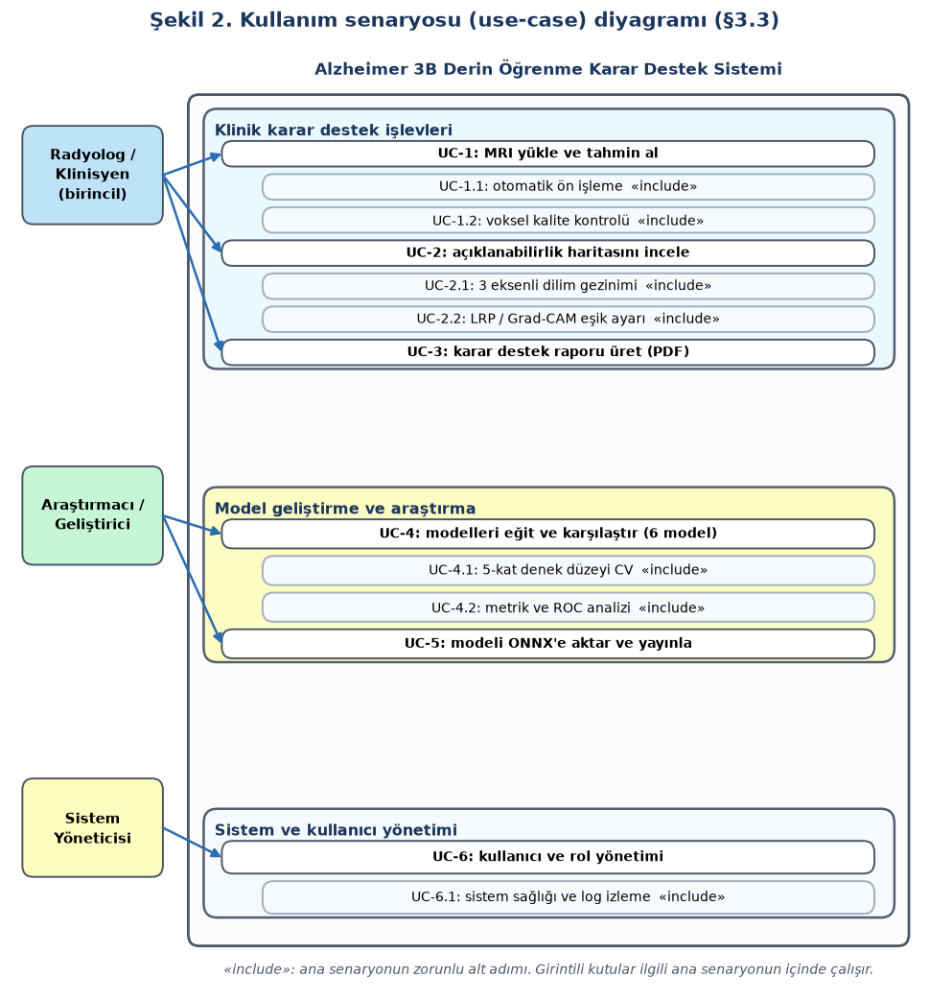
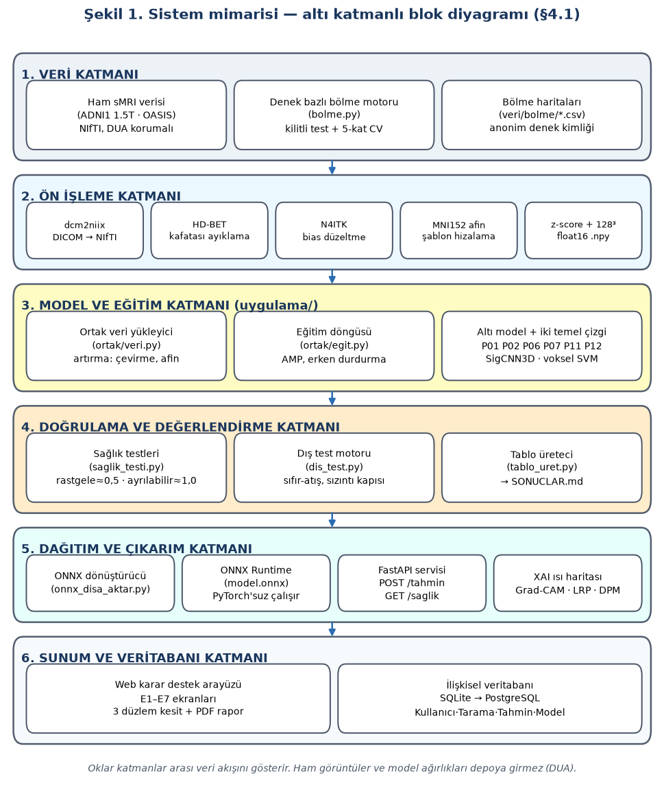
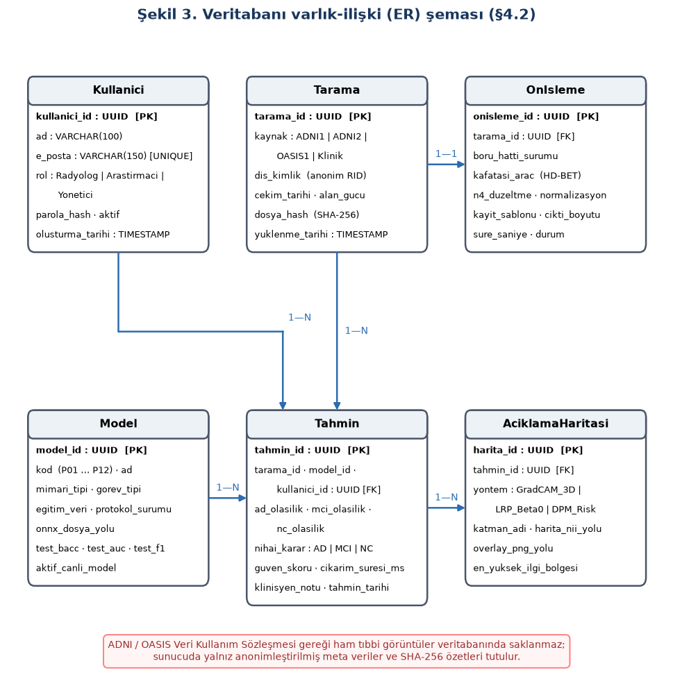
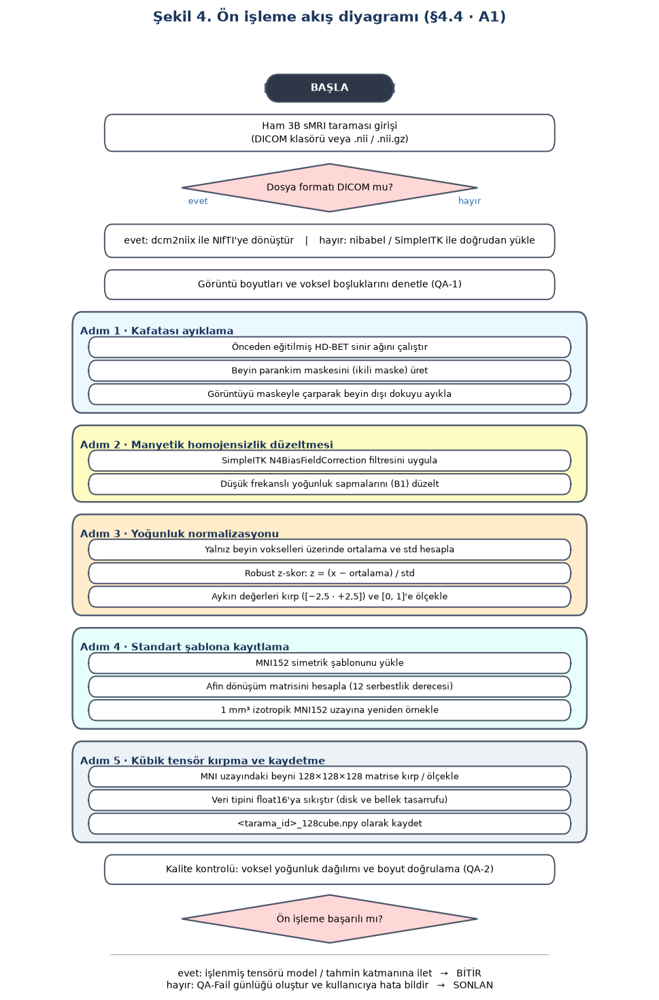
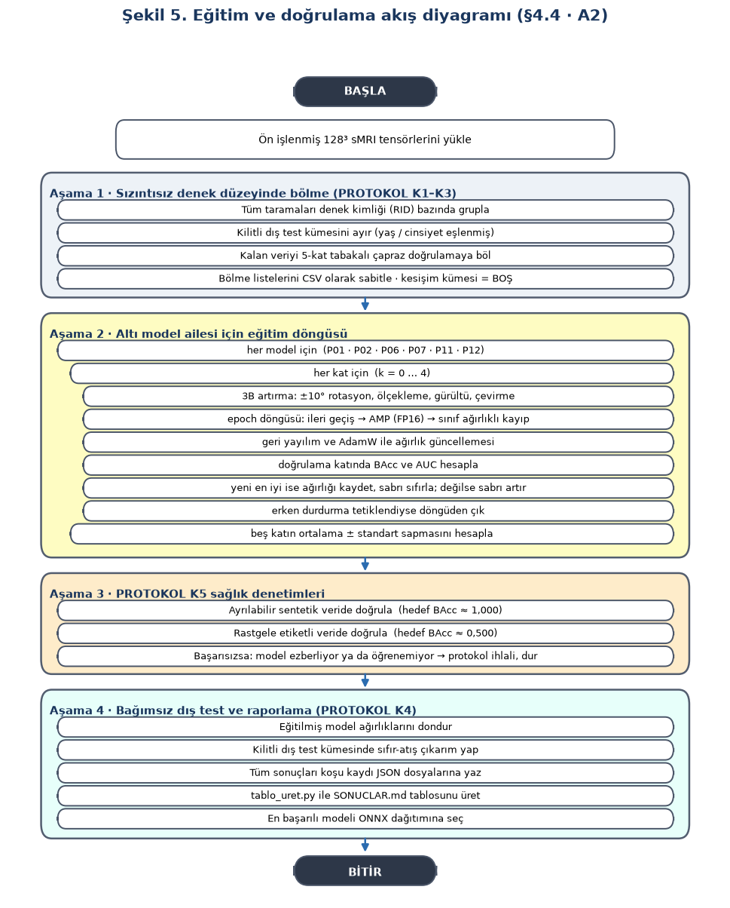
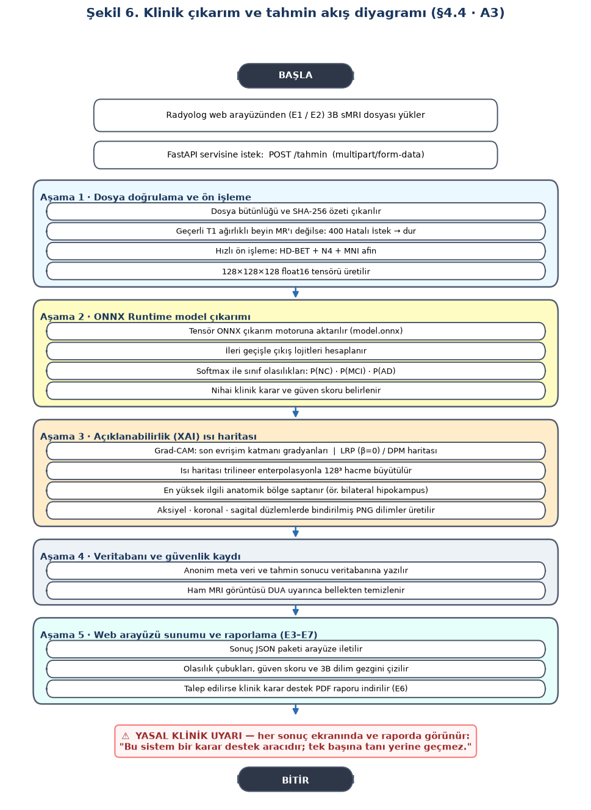

# 2. ARA RAPOR — ANALİZ VE TASARIM

## KAPAK

**Proje adı:** Alzheimer Hastalığının Erken Teşhisi İçin 3B Derin Öğrenme Tabanlı Karar Destek Sistemi Geliştirilmesi

**Öğrenciler:**
Ahmet Görkem Yavuz (G231210032) · Ertuğrul Kabaoğlu (G231210376) · Baran Yeşilyurt (G231210078)

**Danışman:** Dr. Öğr. Üyesi Can Yüzkollar

**Ders:** BSM 401 Bilgisayar Mühendisliği Tasarımı — 2026-2027 Güz

**Proje deposu:** https://github.com/YesilBaraN/tasarim-alzheimer

---

## 1. GİRİŞ — BİRİNCİ ARA RAPORDAN BU YANA YAPILANLAR

Birinci ara raporda projenin konusunu, amacını ve genel yaklaşımını tanımlamıştık. Bu rapor,
o tanımın üzerine kurulan **analiz ve tasarım** çalışmasını sunmaktadır.

Geçen dönem içinde tamamladığımız işler:

- **Konu ve danışman formu** teslim edildi (24.10.2026).
- **Literatür taraması:** 27 aday makale tarandı; açık erişim ve açık kaynak kod ölçütleriyle
  **15 makale** seçildi, üç tematik gruba ayrıldı ve ekip üyelerine atandı. Her makale için
  on dört bölümlük ayrıntılı inceleme notu yazıldı; notların on üçüncü bölümü makaledeki
  sayısal iddiaların tutarlılığını denetlemeye ayrıldı ve **dört makalede çelişki saptanıp
  belgelendi** (ayrıntı `makaleler/` klasöründe).
- **Ortak veri seti kararı:** ADNI1 1.5T T1 başlangıç taramaları (NC / MCI / AD) birincil
  veri seti olarak seçildi; ADNI ve OASIS erişim başvuruları yapıldı, onay beklenmektedir.
  Onay süreci boyunca çalışmanın durmaması için açık erişimli bir köprü veri seti belirlendi.
- **Ön işleme hattı, adil karşılaştırma protokolü ve ortak eğitim altyapısı** tasarlandı ve
  gerçekleştirildi (`onisleme/`, `uygulama/PROTOKOL.md`, `uygulama/ortak/`).
- **Tasarımın doğrulanması:** Bu raporda sunulan tasarım yalnız kâğıt üzerinde kalmamış,
  çalışan koda dönüştürülmüştür. Altı mimarinin tamamı ortak sözleşmeye uygun olarak
  kodlanmış, sürekli bütünleştirme (GitHub Actions) ile Windows ve Ubuntu üzerinde
  otomatik sınanmaktadır. Bu, tasarım kararlarının uygulanabilirliğinin kanıtıdır.

### 1.1 Projenin özgün yanı

Literatürde Alzheimer teşhisi için önerilmiş çok sayıda 3B derin öğrenme mimarisi vardır ve
her biri kendi makalesinde yüksek başarı bildirmektedir. Ancak bu sayılar **birbiriyle
karşılaştırılabilir değildir**: her çalışma farklı veri alt kümesi, farklı ön işleme hattı ve
farklı bölme yöntemi kullanmaktadır. Wen vd. [3] otuz iki çalışmayı inceleyip on altısında
veri sızıntısı olasılığı saptamış; Yagis vd. [5] dilim düzeyinde bölme yapıldığında doğruluğun
**25–55 puan** şiştiğini deneysel olarak göstermiştir.

Projemizin özgün katkısı yeni bir mimari önermek değil, literatürdeki **altı farklı mimariyi
aynı veri, aynı bölme ve aynı eğitim yordamı altında yan yana koymaktır**. Bu yüzden işe
model yazarak değil, bağlayıcı bir **protokol** yazarak başladık.

---

## 2. DETAYLI LİTERATÜR TARAMASI

Seçilen on beş makale üç tematik grupta incelenmiştir. Her grup bir ekip üyesine atanmış,
inceleme notları ortak şablonla yazılmıştır.

### 2.1 Üç boyutlu CNN temelleri ve ResNet omurgası (Baran Yeşilyurt)

**[1] Korolev vd. (2017) — VoxCNN ve VoxResNet:** Korolev ve ark. [1], 3B beyin MRI
sınıflandırmasında düz evrişimli ağlar ile artık (residual) bağlantılı ağları doğrudan
karşılaştıran ilk çalışmalardan birini sunmuştur. ADNI veri tabanından alınan 231 denek
(50 AD, 43 geç evre MCI, 77 erken evre MCI, 61 NC) üzerinde, ADNI'nin kendi hazır N3
düzeltilmiş ve hizalanmış çıktıları $110^3$ voksel boyutunda kullanılmıştır. VoxCNN, VGG
benzeri dört evrişim bloğundan (8-16-32-64 filtre) oluşan düz bir mimaridir; VoxResNet ise
altı artık blok içeren 21 katmanlı daha derin bir ağdır. Beş kez tekrarlanan beş katlı çapraz
doğrulamada AD vs. NC görevinde VoxCNN 0,88 ± 0,08, VoxResNet 0,87 ± 0,07 AUC elde etmiştir
(doğruluk sırasıyla %79 ve %80). Çalışmanın dürüst biçimde bildirdiği kritik bulgu, **ara
sınıflarda (EMCI vs. LMCI) başarının şans düzeyine düşmesidir** — bu, erken evre ayrımının
yapısal MRI ile ne kadar zor olduğunun erken bir kanıtıdır. Yöntemsel zayıflığı, ayrı bir iç
doğrulama kümesi bulunmaması ve model seçiminin aynı çapraz doğrulama üzerinden yapılmasıdır;
bu, ılımlı düzeyde bir model seçimi sızıntısı yaratmaktadır. Projemizde bu iki mimari, **alt
sınır referansı** olarak birinci ve ikinci modelimizi oluşturmaktadır.

**[2] Chen vd. (2019) — Med3B / MedicalNet transfer öğrenme:** Chen ve ark. [2], 3B tıbbi
görüntü analizinde en büyük kısıtın etiketli veri azlığı olduğu tespitinden yola çıkarak,
sekiz farklı veri kümesini birleştiren 3DSeg-8 havuzunda (1.638 hacim; BT ve MR; BraTS,
hipokampüs, akciğer vb.) önceden eğitilmiş bir 3B ResNet ailesi (ResNet-10'dan ResNet-200'e)
yayımlamıştır. Aktarım deneylerinde akciğer segmentasyonunda Dice skoru sıfırdan eğitime göre
75,22'den **87,26**'ya, akciğer nodülü sınıflandırmasında doğruluk %80,80'den **%88,89**'a
yükselmiş; dahası yakınsama iki ila on kat hızlanmıştır. Projemiz açısından bu çalışmanın iki
değeri vardır: birincisi, MIT lisanslı ağırlıklar doğrudan kullanılabilmektedir; ikincisi,
makale **sıfırdan eğitim temel çizgisini şart koşmaktadır** — transfer öğrenmenin kazancı
ancak aynı mimarinin sıfırdan eğitilmiş hâliyle karşılaştırılarak gösterilebilir. Bu yüzden
projemizde P02 iki ayrı koşu olarak tasarlanmıştır: ön eğitimli ve sıfırdan.

**[3] Wen vd. (2020) — tekrarlanabilir değerlendirme ve veri sızıntısı:** Wen ve ark. [3],
alandaki otuz iki çalışmayı sistematik olarak tarayıp **on altısında veri sızıntısı olasılığı**
saptamış ve dört sızıntı türünü tanımlamıştır: yanlış veri bölme, geç ayrılan test kümesi,
sızdıran transfer öğrenme ve eksik bağımsız test. Ardından ADNI (1.455 denek), AIBL (598) ve
OASIS (193) üzerinde, test kümesi hakem sürecinin sonuna kadar **kilitli tutularak** dört farklı
girdi yaklaşımını (tüm beyin 3B, hipokampüs ROI, 3B yama, 2B dilim) aynı protokolle
karşılaştırmıştır. Sızıntısız sonuçlar şunlardır: tüm beyin 3B dengeli doğruluk **0,82**
(boylamsal veriyle 0,85), hipokampüs ROI **0,89**, yama 0,81, 2B dilim 0,76 ve — dikkat çekici
biçimde — **doğrusal SVM 0,88**. Sızıntılı bir 2B kurulumda doğrulama doğruluğunun 1,00'e
çıkarken testte 0,75'e düşmesi, sızıntının nasıl bir yanılsama ürettiğinin açık kanıtıdır.
Bu makale projemizin **protokol kaynağıdır**; `uygulama/PROTOKOL.md` içindeki beş bağlayıcı
kural doğrudan buradan türetilmiştir. Ayrıca doğrusal SVM sonucu, derin öğrenmenin bu veri
ölçeğinde otomatik olarak üstün olmadığını gösterdiği için projemize **voksel tabanlı SVM
temel çizgisini** eklememizin gerekçesidir.

**[4] Folego vd. (2020) — ADNet ve bağımsız dış test:** Folego ve ark. [4], tüm beyin 3B
girdisiyle çalışan ADNet mimarisini (3B VGG-512, 26,8 milyon parametre) geliştirmiş ve ADNI1
üzerinde 845 denek / 9.149 görüntü ile eğitmiştir. Ön işleme zinciri ANTs tabanlıdır: bias
düzeltme, rijit ve afin kayıt, SyN doğrusal olmayan dönüşüm ile MNI152 2009c uzayına hizalama
ve atlas maskesi. Çalışmanın en değerli yanı, modeli **tamamen bağımsız** CADDementia yarışma
kümesinde (354 denek) sınamasıdır: üç sınıflı görevde doğruluk yalnızca **%51,4**, tüm sınıflar
için AUC 0,709 olmuştur. Kırk sekiz sistem arasında 21. sırada yer alan bu sonuç, iç test
başarısının dış genellemeyi garanti etmediğinin ve **üç sınıflı görevin ikili görevden belirgin
şekilde zor olduğunun** somut kanıtıdır. Projemizde bu bulgu, üç sınıflı görevi ikincil olarak
konumlandırma kararımızın temelini oluşturmaktadır.

**[5] Yagis vd. (2021) — veri sızıntısının deneysel kanıtı:** Yagis ve ark. [5], bölme
yönteminin sonuç üzerindeki etkisini doğrudan ölçmek için tasarlanmış bir deney kurmuştur.
OASIS, ADNI, PPMI ve Versilia kümelerinden alınan 2B kesitlerle VGG16 ve ImageNet ön eğitimli
ResNet-18 modelleri, iki farklı bölme stratejisiyle eğitilmiştir: denek düzeyinde ve kesit
düzeyinde. Sonuç çarpıcıdır: AD / sağlıklı ayrımında denek düzeyinde bölme ile %66–70 arasında
kalan doğruluk, kesit düzeyinde bölme ile **%94–99**'a çıkmaktadır; şişme **25–55 puandır**.
Daha da belirleyicisi, araştırmacılar etiketleri **rastgele karıştırdıklarında** kesit düzeyi
bölmenin hâlâ %94–96 doğruluk ürettiğini, denek düzeyi bölmenin ise beklendiği gibi %50'de
kaldığını göstermiştir. Yani kesit düzeyinde bölünmüş bir kurulum, **öğrenilecek hiçbir şey
olmadığında bile** yüksek skor üretmektedir. Bu bulgu projemizin birinci protokol maddesinin —
bölme her koşulda denek düzeyinde yapılır — tartışmasız gerekçesidir.

### 2.2 Dikkat mekanizmaları ve açıklanabilirlik (Ahmet Görkem Yavuz)

Derin öğrenme modellerinin medikal görüntü analizinde, özellikle Alzheimer hastalığının
nörodejeneratif evrelerinin saptanmasında klinik rutine girememesinin en kritik engeli "kara
kutu" doğalarıdır. Yüksek sınıflandırma doğruluğuna ulaşan bir modelin, kararlarını beyin dışı
gürültülere mi yoksa patolojik doku atrofisine mi dayandırdığı şeffafça ortaya konulmalıdır. Bu
alt grupta, 3B CNN mimarilerine entegre edilen dikkat mekanizmaları (öz-dikkat, kanal/uzamsal
dikkat) ve açıklanabilir yapay zekâ (XAI) yöntemleri (LRP, Grad-CAM, oklüzyon) incelenmiştir.

**[6] Böhle vd. (2019) — Katman Bazlı İlgi Yayılımı (LRP):** Böhle ve ark. [6], 3B evrişimli
sinir ağlarının yapısal MRI üzerindeki sınıflandırma kararlarını voksel düzeyinde açıklamak
amacıyla Katman Bazlı İlgi Yayılımı (Layer-wise Relevance Propagation, LRP) yöntemini
uyarlamıştır. ADNI-1 veri tabanından seçilen 969 tarama (344 denek; 193 AD, 151 CN) üzerinde
CAT12 ile gri madde yoğunluk haritaları ($193 \times 229 \times 193$) çıkarılmış; 4 bloklu
kompakt bir 3B CNN (filtreler: 8-16-32-64, tam bağlantılı katmanlar: 128-2) eğitilmiştir. Denek
düzeyinde 10 katlı çapraz doğrulamada AD vs. NC görevinde %81,93 dengeli doğruluk ve 0,880 AUC
elde edilmiştir. Çalışmanın temel katkısı, yaygın kullanılan Güdümlü Ters Yayılım (Guided
Backpropagation, GB) yöntemi ile LRP'nin sistematik olarak kıyaslanmasıdır. GB yöntemi hem
hastalarda hem de sağlıklı kontrollerde yüksek gradyan tepkisi üreterek "yanlış pozitif" şüphe
uyandırırken, LRP ($\beta=0$ kuralı ile yalnızca pozitif katkı sağlayan yönelimler geri
yayıldığında) sağlıklı kontrollerde neredeyse sıfır ilgi skoru üretmiş ve AD hastalarında
doğrudan hipokampüs ve temporal lob atrofisine odaklanmıştır. Ayrıca LRP ilgi skorlarının
FreeSurfer hipokampal hacimleriyle istatistiksel olarak anlamlı bir ters korelasyon sergilediği
($r = -0{,}560$, $p < 10^{-3}$) kanıtlanmıştır.

**[7] Zhang vd. (2021) — 3D ResAttNet ve öz-dikkat:** Zhang ve ark. [7], standart 3B ResNet
mimarilerine öz-dikkat (self-attention) mekanizması ekleyerek hem AD teşhisini hem de patolojik
atrofinin yerelleştirilmesini sağlayan 3D ResAttNet modelini önermiştir. Klasik
$7\times7\times7$ kök evrişimi yerine üç adet ardışık $3\times3\times3$ evrişim içeren hafif bir
kök katmanı tasarlanmış; artık blokların içine $1\times1\times1$ evrişimlerle sorgu ($Q$),
anahtar ($K$) ve değer ($V$) tensörleri üreten 3B öz-dikkat katmanı entegre edilmiştir. Çıktı,
$y = x + r(x) + \gamma \cdot o(r(x))$ formülüyle artık öğrenmeye bağlanmış; ölçekleyici $\gamma$
katsayısı başlangıçta sıfır yapılarak modelin kararlı yakınsaması sağlanmıştır. ADNI-1
kohortunda (817 denek; 188 AD, 400 MCI, 229 NC) yapılan 10 katlı çapraz doğrulamada ResAttNet34;
AD vs. NC görevinde %91,3 ± %1,2 doğruluk ve **0,984 ± 0,009 AUC** elde ederek temel ResNet'in
standart sapmasını (%14,7'den %1,2'ye) çarpıcı şekilde düşürmüştür. Model ayrıca erken evre
pMCI vs. sMCI ayrımında %82,1 doğruluk ve 0,920 AUC başarımı göstermiş; ADNI-2 (3T) harici
testinde %82,6 doğruluk ve 0,927 AUC ile çok merkezli genellenebilirliğini kanıtlamıştır. Ağın
üçüncü katmanından ($46\times55\times46$) türetilen 3B Grad-CAM ısı haritaları, son katmanın
aşırı bulanık $6\times7\times6$ haritalarına kıyasla hipokampal ve parahipokampal sınırları
yüksek anatomik çözünürlükle yerelleştirmiştir.

**[8] Dyrba vd. (2021) — etkileşimli ilgi haritaları ve biyobelirteç doğrulaması:** Dyrba ve
ark. [8], 3B CNN kararlarının anlaşılabilirliğini artırmak için LRP tabanlı ilgi haritalarını
etkileşimli bir web karar destek arayüzüyle birleştirmiştir. ADNI-GO/2 kohortundan $N = 663$ T1
MRI taraması (denek başına tek tarama; 254 CN, 220 MCI, 189 AD) üzerinde eğitilen üç bloklu 3B
CNN (~700 bin parametre), normal yaşlanma etkilerini ayıklamak için sağlıklı kontroller
üzerinden doğrusal kovaryat regresyonu (yaş, cinsiyet, TIV, 1.5T/3T alan şiddeti) ile
arındırılmış "artık gri madde hacimleri" ile beslenmiştir. Model, bugüne kadarki en geniş
bağımsız çok merkezli harici test havuzlarından birinde ($N = 1.655$; ADNI-3: 575, AIBL: 606,
DELCODE: 474) sınanmış ve AD vs. CN ayrımında tüm bağımsız kohortlarda **AUC $\ge 0{,}91$**
($0{,}913-0{,}953$; dengeli doğruluk %80,5–%85,5) korunmuştur. iNNvestigate tabanlı LRP ile elde
edilen ilgi haritaları, AAL atlası hipokampüs hacmiyle **$r = -0{,}87$ ($p < 0{,}001$)**
düzeyinde güçlü bir ters korelasyon sergilemiş; Bokeh tabanlı açık kaynaklı web arayüzüyle
klinisyenin üç eksende dilim gezinimi, AAL anatomik etiketleri ve küme boyut eşikleme yapabilmesi
sağlanmıştır.

**[9] Hoang vd. (2023) — 3D-DAM çift dikkat modülü:** Hoang ve ark. [9], 2B bilgisayarlı
görmedeki Convolutional Block Attention Module (CBAM) mekanizmasını 3B medikal tensörlere
genişleterek hem kanal ilişkilerini hem de anatomik hacimdeki uzamsal ilişkileri yakalayan 3D-DAM
mimarisini önermiştir. Modelde kanal dikkati; 3B ortalama ve maksimum havuzlamanın ardından
paylaşımlı bir çok katmanlı algılayıcı ile kanallar arası bağıntıyı optimize ederken, uzamsal
dikkat kanallar boyunca alınan ortalama ve maksimum haritalarını $3\times3\times3$ evrişimle
süzerek kritik vokselleri öne çıkarmaktadır. ADNI'den seçilen 1.426 denek (403 AD, 653 CN, 165
pMCI, 205 sMCI), Clinica platformunun `t1-linear` boru hattı (N4ITK bias düzeltme + ANTs afin
MNI ICBM2009c hizalama) üzerinden BIDS biçimine dönüştürülmüştür. 3D-DAM modeli, ADNI test
kümesinde AD vs. CN için **%98,18 ± %0,42** doğruluk (duyarlılık %96,73, özgüllük %98,97) ve
erken evre pMCI vs. sMCI tahmini için **%91,78 ± %0,63** doğruluk elde etmiştir. Yöntemin
genellenebilirliği AIBL (%86,37) ve OASIS-1 (%83,42) bağımsız veri setlerinde, ayrıca tersine
eğitim senaryosunda (AIBL + OASIS eğitim $\rightarrow$ ADNI test: %85,4) sınanmıştır.

**[10] Jin vd. (2020) — 3DAN ve nörobilimsel olarak yorumlanabilir biyobelirteçler:** Jin ve
ark. [10], 3B ResNet-18 mimarisi üzerine tek bir $3\times3\times3$ evrişim katmanıyla
eğitilebilir uzamsal dikkat haritası ekleyen hafif 3DAN mimarisini geliştirmiştir. Çalışma, altı
farklı hastane ve tarayıcıdan toplanan Çin kurum içi kohortu ($N = 716$) ile Kuzey Amerika ADNI
kohortu ($N = 1.116$) olmak üzere toplam **$N = 1.832$** denek üzerinde yürütülmüştür. CAT12 ile
2 mm izotropik voksele ($91 \times 109 \times 91$) getirilen gri madde yoğunlukları üzerinde dört
çapraz doğrulama stratejisi uygulanmıştır: kurum içi $\rightarrow$ ADNI harici testinde %86,1
doğruluk ve 0,912 AUC; ADNI $\rightarrow$ kurum içi harici testinde %87,0 doğruluk ve 0,913 AUC;
merkez dışı bırakmada %90,9 doğruluk; ADNI 10 katlı çapraz doğrulamada %92,1 doğruluk ve 0,941
AUC. Çalışmanın en özgün yönü, üretilen 3B dikkat haritalarının 273 bölgeli Brainnetome Atlası
ile eşleştirilerek gri madde atrofi istatistikleriyle ($r = 0{,}59$), MMSE skorlarıyla, beyin
omurilik sıvısı amiloid-$\beta$ / tau düzeyleriyle ve APOE $\epsilon4$ genotipiyle doğrudan
nörobiyolojik korelasyonunun kanıtlanmış olmasıdır.

### 2.3 Yama/FCN, DenseNet ve Transformer (Ertuğrul Kabaoğlu)

**[11] Qiu vd. (2020) — FCN ile yama düzeyi risk haritası:** Qiu ve ark. [11], 3B T1 sMRI
verilerinden Alzheimer teşhisi koymak ve yüksek çözünürlüklü hastalık olasılık haritaları üretmek
amacıyla tam evrişimli ağ (FCN) ile çok katmanlı algılayıcıyı birleştiren iki aşamalı bir mimari
geliştirmiştir. Model geliştirme aşamasında $47 \times 47 \times 47$ voksellik yerel 3B yamalar
üzerinde dört evrişim bloklu FCN eğitilmiş; çıkarım evresinde tam bağlantılı katmanlar evrişim
çekirdeklerine dönüştürülerek, kaydırma penceresi döngülerine gerek kalmadan tüm beyin için tek
bir ileri geçişte kesintisiz **hastalık olasılık haritası** (Disease Probability Map, DPM) elde
edilmiştir. DPM haritasından seçilen en yüksek riskli $K=200$ voksel değeriyle eğitilen nihai
sınıflandırıcı, ADNI test kümesinde yalnızca MRI verisiyle **%83,4 ± 2,0** doğruluk (duyarlılık
%76,7, özgüllük %88,9) elde ederek on bir bağımsız uzman nöroloğun ortalama teşhis başarısını
(%82,3 ± 9,4) geride bırakmıştır. Klinik değişkenler (yaş, cinsiyet, MMSE) eklendiğinde doğruluk
%96,8'e ve AUC 0,996'ya yükselmiştir. Ayrıca AIBL (%87,0), FHS (%76,6) ve NACC (%81,8) olmak
üzere dört kohortta toplam 1.466 denek üzerinde genellenebilirlik gösterilmiş; Framingham Kalp
Çalışması'ndan otopsi yapılmış on bir hastada modelin işaret ettiği yüksek riskli vokseller
amiloid-$\beta$ ve nörofibriler yumak histopatolojisiyle mekânsal olarak örtüşmüştür. Çalışmanın
MIT lisanslı açık kaynak kodu, projemizin beşinci implementasyon modelinin temelini
oluşturmaktadır.

**[12] Solano-Rojas ve Villalón-Fonseca (2021) — düşük maliyetli 3B DenseNet-121:**
Solano-Rojas ve ark. [12], gelişmekte olan ülkelerdeki araştırmacıların yüksek maliyetli GPU
sunucularına erişim kısıtını aşmak amacıyla, tamamen ücretsiz bulut bilişim kaynakları üzerinde
çalışabilen bir 3B DenseNet-121 mimarisi önermiştir. ADNI'den indirilen 5.556 adet 3B T1 MRI
taramasından gürültülü olduğu tespit edilen sübjektif bellek kaygısı sınıfı elenerek 5.370 tarama
ile beş sınıflı bir evreleme kurgulanmıştır. Voksel aralıkları 1 mm³ ve $256^3$ küboid boyuta
getirilen görüntüler üzerinde mikro-ortalama %84 doğruluk, %81 duyarlılık, %84 özgüllük ve %92
AUROC bildirilmiştir. Ancak inceleme notumuzda saptadığımız üzere çalışmada **eğitim/test ayrımı
denek düzeyinde değil, tüm taramalar üzerinden rastgele %75 / %25 yapılmıştır**; aynı hastanın
boylamsal vizitleri her iki kümeye dağılarak kritik düzeyde veri sızıntısı oluşmuştur. Ayrıca
özette bildirilen %87 doğruluk ile metin içindeki %84 değeri çelişmektedir. Projemizde 3B
DenseNet-121, Apache-2.0 lisanslı MONAI omurgasıyla ve **sızıntısız denek bazlı beş katlı çapraz
doğrulama altında** altıncı modelimiz olarak gerçekleştirilmektedir.

**[13] Lian vd. (2020) — hiyerarşik FCN ile birleşik atrofi tespiti ve teşhis:** Lian ve ark.
[13], yapısal MRI görüntülerinde hastalıkla ilişkili yerel beyin atrofisi tespiti ile global
Alzheimer teşhisini tek bir uçtan uca mimaride birleştiren Hiyerarşik Tam Evrişimli Ağ (H-FCN)
önermiştir. Çok ölçekli yerel yamalardan ($32^3$ ve $64^3$) hiyerarşik öznitelik çıkaran ve her
yamanın ayırt ediciliğini ağ içinde otomatik ağırlıklandıran model; ADNI-1 başlangıç kohortundaki
830 denek (229 NC, 226 sMCI, 167 pMCI, 199 AD) üzerinde denek düzeyinde on katlı çapraz
doğrulamayla AD vs. NC ikili sınıflandırmasında **%90,3** doğruluk, %82,4 duyarlılık, %96,5
özgüllük ve **0,951** AUC; pMCI vs. sMCI dönüşüm tahmininde ise %80,9 doğruluk ve 0,781 AUC elde
etmiştir. Model ADNI-2 kohortunda eğitilip ADNI-1'de bağımsız dış test edildiğinde %89,5 doğruluk
ve 0,945 AUC sergileyerek literatürdeki en sağlam sızıntısız başarı referanslarından birini
sunmuştur. Bu sonuç, projemizin birincil hedefi olan "AD vs. NC görevinde $\ge$ %85 dengeli
doğruluk" için ampirik bir tavan referansı sağlamaktadır.

**[14] Jang ve Hwang (2022) — M3T: çok düzlemli ve çok dilimli Transformer:** Jang ve ark. [14],
saf 3B Vision Transformer'ların medikal görüntü kıtlığında yaşadığı aşırı uyum ve ağır hesaplama
maliyeti sorununu aşmak amacıyla, 3B CNN, 2B CNN ve Transformer bileşenlerini harmanlayan hibrit
M3T mimarisini (29,12 milyon parametre) geliştirmiştir. İlk blokta yerel 3B uzamsal ilişkileri
yakalayan hafif bir 3B CNN, ikinci blokta beynin aksiyel, koronal ve sagital düzlemlerinden
çıkarılan çoklu 2B dilimleri işleyen ImageNet ön eğitimli ResNet-50 omurgası, son blokta ise
düzlemler ve dilimler arası uzun menzilli dikkat ilişkilerini modelleyen sekiz katmanlı bir
Transformer kodlayıcı kullanılmıştır. ADNI'den 4.786 tarama ile eğitilen model; bağımsız ADNI
test kümesinde %93,21 doğruluk ve 0,9634 AUC, AIBL'de %93,27 doğruluk, OASIS'te ise **%85,26**
doğruluk ve 0,8961 AUC elde etmiştir. Saf 3B ViT'in (AUC 0,8851) açık ara geride kaldığı bu
çalışma, 3B medikal analizde CNN tabanlı hibrit Transformer yapılarının gerekliliğini ortaya
koymakta ve projemizde yürütülecek dış testte hedeflenebilecek başarı aralığını (%82–85)
göstermektedir.

**[15] Dhinagar vd. (2023) — video ve sentetik MRI ön eğitimiyle ViT ve CNN karşılaştırması:**
Dhinagar ve ark. [15], 3B nörogörüntüleme analizinde Vision Transformer ve CNN mimarilerinin
transfer öğrenme kabiliyetlerini; Kinetics-400 (306.245 doğal insan eylem videosu), üretici model
ile oluşturulmuş 100.000 sentetik 3B MRI ve UK Biobank (38.703 gerçek MRI) gibi büyük ölçekli
veri kümeleri üzerinden ön eğitime tabi tutarak kıyaslamıştır. Swin-T (27M), ViT-B/16 (8M), 3B
DenseNet-121 (11M) ve 3B Tiny DenseNet (1,8M) mimarilerinin ADNI ince ayar ve bağımsız OASIS
sıfır-atış dış test sonuçları; sıfırdan eğitimde 3B DenseNet-121'in (**0,901** AUC, **%84,0**
OASIS doğruluk) saf Transformer'ları (0,849 AUC) açık farkla geride bıraktığını, video ön
eğitiminin ise Swin-T'yi 0,924 AUC'ye çıkardığını göstermiştir. En dikkat çekici bulgu, yalnızca
1,8 milyon parametreli hafif 3B Tiny DenseNet'in %83,6 OASIS doğruluğu elde ederek on bir milyon
parametreli DenseNet-121 ile neredeyse aynı başarıyı sunmasıdır; bu, projemizde hem standart hem
hafif DenseNet varyantlarının tasarlanması kararını desteklemektedir.

### 2.4 On beş makalenin karşılaştırmalı özeti

| Kod | Çalışma | Veri (N) | Bölme / sızıntı riski | En iyi sonuç | Projedeki rolü |
|---|---|---|---|---|---|
| P01 | Korolev 2017 | ADNI 231 denek | 5×5 CV, iç doğrulama yok — **orta** | AD-NC AUC 0,88 | Model 1 · alt sınır |
| P02 | Chen 2019 | 3DSeg-8, 1.638 hacim | tek bölme, doğrulama yok — **orta** | aktarımda +8 Dice | Model 2 · transfer |
| P03 | Wen 2020 | ADNI 1.455 · AIBL 598 · OASIS 193 | kilitli test, 5 kat — **düşük** | 3B 0,82 · ROI 0,89 · SVM 0,88 | **Protokol kaynağı** |
| P04 | Folego 2020 | ADNI1 845 denek | görüntü düzeyi metrik — **orta** | dış test %51,4 (3 sınıf) | Üç sınıfın zorluğu |
| P05 | Yagis 2021 | OASIS · ADNI · PPMI | denek vs kesit karşılaştırması | kesit düzeyi +25–55 puan | **Madde 1 kanıtı** |
| P06 | Böhle 2019 | ADNI-1, 344 denek | denek düzeyi 10 kat — **düşük** | BAcc %81,93 · AUC 0,88 | Model 3 · LRP |
| P07 | Zhang 2021 | ADNI-1, 817 denek | denek düzeyi 10 kat — **düşük** | AUC 0,984 · dış test 0,927 | Model 4 · öz-dikkat |
| P08 | Dyrba 2021 | 663 eğitim · 1.655 dış test | denek düzeyi — **düşük** | tüm kohortlarda AUC ≥ 0,91 | XAI doğrulama ölçütü |
| P09 | Hoang 2023 | ADNI 1.426 denek | denek düzeyi — **düşük** | %98,18 (iç) · %83,42 (OASIS) | Dikkat modülü referansı |
| P10 | Jin 2020 | 1.832 denek, 2 kıta | merkez dışı bırakma — **düşük** | %92,1 · dış %86–87 | Biyobelirteç doğrulama |
| P11 | Qiu 2020 | ADNI + 3 dış kohort, 1.466 | denek düzeyi — **düşük** | %83,4 (yalnız MRI) | Model 5 · FCN-yama |
| P12 | Solano-Rojas 2021 | ADNI 5.370 tarama | **tarama düzeyi — yüksek** | %84 (sızıntılı) | Model 6 · DenseNet |
| P13 | Lian 2020 | ADNI-1 830 denek | denek düzeyi 10 kat — **düşük** | %90,3 · AUC 0,951 | Hedef tavan referansı |
| P14 | Jang 2022 | ADNI 4.786 tarama | bağımsız test — **düşük** | %93,21 · OASIS %85,26 | Dış test hedef aralığı |
| P15 | Dhinagar 2023 | UK Biobank 38.703 + ADNI | sıfır-atış dış test — **düşük** | DenseNet 0,901 AUC | Ön eğitim stratejisi |

### 2.5 Literatürden çıkan tasarım kararları

1. **Bölme her koşulda denek düzeyinde yapılır.** Aksi hâlde sonuçlar 25–55 puan şişmektedir
   [3], [5]. Bu, protokolümüzün birinci ve tartışmaya kapalı maddesidir.
2. **≥ %85 doğruluk hedefi yalnız AD vs. NC görevinde gerçekçidir.** Üç sınıflı görevde
   sızıntısız dış test sonuçları %50–60 bandındadır [3], [4]; bu görev ikincil olarak ve dürüstçe
   raporlanacaktır.
3. **Altı mimari aynı ön işleme ve aynı protokolle karşılaştırılır.** Literatürdeki asıl boşluk
   budur: her makale kendi kurulumunda yüksek sonuç bildirmekte, ancak ortak protokolle yan yana
   karşılaştırma bulunmamaktadır.
4. **Derin öğrenme temel çizgisiz anlamlı değildir.** Wen vd. [3] doğrusal SVM ile 0,88 dengeli
   doğruluk elde etmiştir; bu yüzden tasarıma hem sığ 3B CNN hem voksel tabanlı SVM temel
   çizgileri dahil edilmiştir.
5. **Açıklanabilirlik sistemin isteğe bağlı bir eklentisi değil, parçasıdır** [6], [7], [8].
   Kararın hangi anatomik bölgeden geldiğini gösteremeyen bir sistem klinik ortamda
   kullanılamaz.

---

## 3. GEREKSİNİM ANALİZİ

### 3.1 İşlevsel gereksinimler

| No | Gereksinim | Öncelik |
|---|---|---|
| FR-1 | Sistem, T1 ağırlıklı 3B MRI'ı NIfTI (.nii / .nii.gz) veya DICOM klasörü olarak kabul eder | Zorunlu |
| FR-2 | Ön işleme hattı (kafatası ayıklama, N4, normalizasyon, MNI152 hizalama, 128³ boyutlandırma) otomatik çalışır ve her adımın çıktısı kaydedilir | Zorunlu |
| FR-3 | Eğitilmiş model için AD / MCI / NC olasılıkları ve ikili AD-NC kararı üretilir | Zorunlu |
| FR-4 | Karar için açıklanabilirlik haritası (Grad-CAM veya LRP) üretilir ve MRI üzerine bindirilerek gösterilir | Zorunlu |
| FR-5 | Altı model aynı veri ve protokolle eğitilip sonuçları tek tabloda karşılaştırılır | Zorunlu |
| FR-6 | En iyi model ONNX olarak dışa aktarılır ve PyTorch kurulu olmayan ortamda çalıştırılabilir | Zorunlu |
| FR-7 | REST API (`POST /tahmin`) ile görüntü gönderilip JSON sonuç alınır | Zorunlu |
| FR-8 | Web arayüzü: görüntü yükle → sonuç + ısı haritası + güven skoru + PDF rapor | İstenen |
| FR-9 | Tahmin kayıtları (meta veri, sonuç, model sürümü, zaman) veritabanında saklanır | İstenen |
| FR-10 | Kullanıcı girişi ve rol yönetimi (radyolog / araştırmacı / yönetici) | İsteğe bağlı |

### 3.2 İşlevsel olmayan gereksinimler

| No | Gereksinim | Ölçüt |
|---|---|---|
| NFR-1 | **Model başarımı:** AD-NC testinde dengeli doğruluk ≥ %85, AUC ≥ 0,90; üç sınıf dürüstçe raporlanır | PROTOKOL ile ölçülür |
| NFR-2 | **Yanıt süresi:** tek görüntü için ön işleme + tahmin ≤ 5 dk (CPU), ≤ 30 sn (GPU) | ölçülecek |
| NFR-3 | **Tekrarlanabilirlik:** sabit tohum, kayıtlı bölme listeleri, sürümü sabitlenmiş bağımlılıklar, her koşuda git commit kaydı | kontrol listesi |
| NFR-4 | **Güvenlik ve gizlilik:** ADNI / OASIS veri kullanım sözleşmesine uyum; ham görüntü sunucuda kalıcı saklanmaz; kimlik bilgisi tutulmaz | tasarım kararı |
| NFR-5 | **Taşınabilirlik:** Windows ve Linux, GPU'lu veya GPU'suz; ONNX ile çerçeveden bağımsız | sürekli bütünleştirme |
| NFR-6 | **Lisans uyumu:** yalnız MIT / Apache / BSD bileşenler; GPL kod türetilmez | envanter tablosu |
| NFR-7 | **Kullanılabilirlik:** hekim üç tıkla sonuca ulaşır; her sonuç ekranı "karar desteğidir, tanı değildir" uyarısı taşır | kullanıcı testi |
| NFR-8 | **Bakım kolaylığı:** modüler yapı (ortak veri / metrik / eğitim katmanı), her model ayrı klasörde, sürüm kontrolü | yapı denetimi |

### 3.3 Kullanım senaryoları

**Aktörler:** Radyolog / klinisyen (birincil kullanıcı), araştırmacı / geliştirici, sistem yöneticisi.

| UC | Ad | Aktör | Özet akış |
|---|---|---|---|
| UC-1 | MRI yükle ve tahmin al | Radyolog | NIfTI / DICOM seç → otomatik ön işleme → model → olasılıklar ve karar |
| UC-2 | Açıklama haritasını incele | Radyolog | UC-1 sonrası ısı haritası katmanını aç / kapat, üç düzlemde dilimler arasında gez |
| UC-3 | Karar destek raporu üret | Radyolog | Sonuç + harita + model sürümü → PDF |
| UC-4 | Modelleri eğit ve karşılaştır | Araştırmacı | Veri seti seç → protokol → altı model → sonuç tablosu |
| UC-5 | Modeli yayınla | Araştırmacı | En iyi modeli ONNX'e aktar → API'ye bağla |
| UC-6 | Kullanıcı ve rol yönet | Yönetici | Kullanıcı ekle, rol ata, sistem sağlığını izle |

---

## 4. TASARIM

### 4.1 Sistem mimarisi

Sistem altı katmandan oluşur. Katmanlar arasındaki tek yönlü veri akışı, her katmanın
bağımsız olarak sınanabilmesini sağlar.

1. **Veri katmanı.** Ham NIfTI görüntüler dış diskte tutulur ve **depoya girmez**. Bölme
   motoru denek düzeyinde kilitli test kümesi ve beş katlı çapraz doğrulama üretir. Klinik
   sütun içeren bölme dosyaları yerelde kalır; depoya yalnız denek kimliği, bölüm ve kat
   numarası taşıyan harita girer — bu, veri kullanım sözleşmesine uyarken üç ekip üyesinin
   birebir aynı bölmeyi kullanabilmesini sağlar.
2. **Ön işleme katmanı.** DICOM dönüştürme → kafatası ayıklama (HD-BET) → N4 bias düzeltme →
   MNI152 afin kayıt → maske içi z-skor → 128³ float16 tensör. Her adımın süresi, uyarıları ve
   kalite ölçütleri bir meta JSON dosyasına yazılır.
3. **Model ve eğitim katmanı.** Ortak veri yükleyici ve ortak eğitim döngüsü **bir kez**
   yazılmıştır; modeller yalnızca tek satırlık bir arayüz sözleşmesi uygular. Bu tasarım kararı
   karşılaştırmanın adilliğinin teknik güvencesidir: hiç kimse kendi eğitim döngüsünü yazmaz.
4. **Doğrulama ve değerlendirme katmanı.** Sağlık testleri hattın kendisini denetler, dış test
   motoru başka bir veri setinde sıfır-atış ölçüm yapar, tablo üreteci koşu kayıtlarından sonuç
   tablosunu otomatik üretir ve protokole uymayan koşuları gerekçesiyle ayıklar.
5. **Dağıtım ve çıkarım katmanı.** Seçilen model ONNX'e aktarılır; karar destek sınıfı onu
   `onnxruntime` ile yükleyerek PyTorch kurulu olmayan ortamda da çalışır.
6. **Sunum ve veritabanı katmanı.** Web arayüzü ve ilişkisel veritabanı.

### 4.2 Veritabanı tasarımı

ADNI / OASIS görüntüleri veritabanına **konmaz**; bu bir tasarım tercihi değil, veri kullanım
sözleşmesinin gereğidir. Sunucuda yalnız anonimleştirilmiş meta veriler, SHA-256 bütünlük
özetleri ve tahmin kayıtları tutulur. Geliştirme SQLite ile başlar, gerektiğinde PostgreSQL'e
taşınabilir.

| Varlık | Birincil anahtar | Temel alanlar | İlişki |
|---|---|---|---|
| Kullanici | kullanici_id | ad, e_posta, rol, parola_hash, aktif | 1—N Tahmin |
| Tarama | tarama_id | kaynak, dis_kimlik (anonim), cekim_tarihi, alan_gucu, dosya_hash | 1—1 OnIsleme · 1—N Tahmin |
| OnIsleme | onisleme_id | boru_hatti_surumu, kafatasi_arac, n4, kayit_sablonu, cikti_boyutu, durum | N—1 Tarama |
| Model | model_id | kod, mimari_tipi, gorev_tipi, protokol_surumu, onnx_yolu, test_bacc, test_auc | 1—N Tahmin |
| Tahmin | tahmin_id | olasılıklar, nihai_karar, guven_skoru, cikarim_suresi_ms, klinisyen_notu | N—1 Tarama, Model, Kullanici |
| AciklamaHaritasi | harita_id | yontem, katman_adi, harita_yolu, en_yuksek_ilgi_bolgesi | N—1 Tahmin |

### 4.3 Arayüz prototipleri

Klinik karar destek arayüzü, hekimin üç tıklamayla hem sonuca hem açıklanabilirlik haritasına
ulaşmasını hedefler. Ayrıntılı ekran bileşenleri ve kullanıcı akışları `rapor/sekiller/mockups_spec.md`
dosyasında tanımlanmıştır.

| Ekran | İçerik ve klinik işlev |
|---|---|
| E1 Giriş | Güvenli oturum açma, rol seçimi, KVKK ve veri kullanım sözleşmesi gizlilik bildirimi |
| E2 Yükle | Sürükle-bırak NIfTI / DICOM yükleyici, otomatik anonim protokol kimliği, meta veri denetimi |
| E3 İşleniyor | Dört adımlı gerçek zamanlı ilerleme çubuğu ve kalan süre sayacı |
| E4 Sonuç | Olasılık çubukları, model güven skoru, **zorunlu yasal uyarı**, model sürüm etiketi |
| E5 Isı haritası | Üç düzlemde senkronize dilim kaydırıcıları, şeffaflık ve eşikleme filtreleri, anatomik bölge etiketi |
| E6 Rapor | Kurumsal başlıklı, kesit görselli, sorumluluk reddi beyanlı PDF önizleme ve indirme |
| E7 Model karşılaştırma | Araştırmacı modu: sonuç tablosu, ROC eğrileri, karışıklık matrisleri, dış test grafiği |

Her sonuç ekranında ve üretilen her raporda şu uyarı değiştirilemez biçimde yer alır:
**"Bu sistem bir karar destek aracıdır; tek başına tanı yerine geçmez."**

### 4.4 Akış diyagramları

Üç ana akış tasarlanmıştır: ön işleme (A1), eğitim ve değerlendirme (A2), klinik çıkarım (A3).

**A1 — Ön işleme akışı.** Giriş biçimi denetlenir, gerekirse NIfTI'ye dönüştürülür; beş adımlı
standartlaştırma hattından geçirilir ve iki kalite kapısıyla (QA-1 giriş, QA-2 çıkış)
denetlenir. Kalite kapısından geçemeyen tarama sessizce kabul edilmez, hata günlüğü üretilir.

**A2 — Eğitim ve değerlendirme akışı.** Dört aşamalıdır: sızıntısız bölme, altı model için
eğitim döngüsü, protokol sağlık denetimleri ve bağımsız dış test ile raporlama. Üçüncü aşama
özellikle önemlidir: hat, rastgele etiketlerle **öğrenmemesi gerektiğini** de kanıtlamak
zorundadır.

**A3 — Klinik çıkarım akışı.** Beş aşamalıdır: dosya doğrulama ve ön işleme, ONNX çıkarımı,
açıklanabilirlik haritası üretimi, veritabanı kaydı ve arayüz sunumu. Dördüncü aşamada ham
görüntü veri kullanım sözleşmesi uyarınca bellekten temizlenir.

### 4.5 Adil karşılaştırma protokolü

Tasarımın en kritik bileşeni, mimarilerin kendisi değil onları karşılaştıran protokoldür.
`uygulama/PROTOKOL.md` beş bağlayıcı kural içerir:

| Kural | İçerik | Dayanağı |
|---|---|---|
| K1 | Bölme denek düzeyinde yapılır; aynı kişinin taramaları tek kümede kalır | [3], [5] |
| K2 | Test kümesi kilitlidir; hiperparametre seçimi yalnız doğrulama üzerinden yapılır | [3] |
| K3 | Tüm modeller aynı ön işleme hattından geçmiş aynı veriyi görür | — |
| K4 | Dış test, eğitim verisiyle kesişmediği doğrulandıktan sonra yapılır | [4], [14] |
| K5 | Hat, sentetik veriyle sağlık testinden geçmeden sonuç üretemez | [3] |

Protokol yalnız belge değildir; tablo üreteci bu kuralları **kodla zorlar** ve kurallara
uymayan koşuyu sonuç tablosuna almaz.

---

## 5. GÜNCELLENMİŞ ZAMAN ÇİZELGESİ

| İş | H5 | H6 | H7 | H8 | H9 | H10 | H11 | H12 | H13 | H14 |
|---|---|---|---|---|---|---|---|---|---|---|
| ADNI / OASIS erişim başvurusu | ■ | ■ | | | | | | | | |
| On beş makale incelemesi | | ■ | ■ | | | | | | | |
| Gereksinim analizi ve kullanım senaryoları | | ■ | ■ | | | | | | | |
| Mimari, ER, akış ve arayüz tasarımı | | | ■ | ■ | | | | | | |
| **Ara Rapor 2 (bu rapor)** | | | | ■ | | | | | | |
| Ön işleme hattı | | | ■ | ■ | ■ | | | | | |
| Altı model eğitimi ve karşılaştırma | | | | ■ | ■ | ■ | | | | |
| Açıklanabilirlik, ONNX, API ve arayüz | | | | | | ■ | ■ | | | |
| **Ara Rapor 3** | | | | | | | ■ | | | |
| Final rapor, poster ve sunum | | | | | | | | ■ | ■ | ■ |

Haftalar: H5 = 24–30 Ekim 2026 … H14 = 26–28 Aralık 2026.

### 5.1 Kaynak kısıtı ve alınan önlem

Tam protokol — dokuz model × iki görev × beş kat × üç tohum = **270 koşu** — tahminen 270–540
GPU-saat gerektirmektedir. Elimizdeki ücretsiz hesaplama bütçesi (üç hesap × haftada yaklaşık
30 GPU-saat × sekiz hafta ≈ 720 saat) bu yükü hata payı bırakmadan ancak karşılamaktadır.

Bu yüzden koşular öncelik katmanlarına bölünmüştür: **birincil görevde (AD vs. NC) beş kat ×
üç tohum korunur**, ikincil üç sınıflı görevde beş kat × tek tohum koşulur ve bu sapma raporda
açıkça belirtilir. Hesap ayrıntısı ve komut sırası `karsilastirma/KOSU-PLANI.md` dosyasındadır.

### 5.2 Danışmana sorulacaklar

1. Hedef metrik: AD vs. NC görevinde ≥ %85 dengeli doğruluk birincil, üç sınıflı görev ikincil
   olarak konumlandırılmıştır. Bu ayrım uygun mudur?
2. Kaynak kısıtı nedeniyle ikincil görevde tohum tekrarının azaltılması kabul edilebilir mi?
3. Üçüncü ve dördüncü ara rapor ile sunum tarihleri, kaynak gösterme biçimi (IEEE öneriyoruz),
   sayfa sınırı ve benzerlik oranı sınırı.
4. ADNI erişim onayı gecikirse açık erişimli köprü veri setiyle savunmaya girmek uygun olur mu?

---

## KAYNAKLAR

[1] S. Korolev, A. Safiullin, M. Belyaev, Y. Dodonova, "Residual and plain convolutional neural
networks for 3D brain MRI classification," *IEEE International Symposium on Biomedical Imaging
(ISBI)*, 2017.

[2] S. Chen, K. Ma, Y. Zheng, "Med3D: Transfer learning for 3D medical image analysis,"
*arXiv:1904.00625*, 2019.

[3] J. Wen vd., "Convolutional neural networks for classification of Alzheimer's disease:
Overview and reproducible evaluation," *Medical Image Analysis*, c. 63, 2020.

[4] G. Folego vd., "Alzheimer's disease detection through whole-brain 3D-CNN MRI," *Frontiers in
Bioengineering and Biotechnology*, c. 8, 2020.

[5] E. Yagis vd., "Effect of data leakage in brain MRI classification using 2D convolutional
neural networks," *Scientific Reports*, c. 11, 2021.

[6] M. Böhle, F. Eitel, M. Weygandt, K. Ritter, "Layer-wise relevance propagation for explaining
deep neural network decisions in MRI-based Alzheimer's disease classification," *Frontiers in
Aging Neuroscience*, c. 11, 2019.

[7] X. Zhang vd., "An explainable 3D residual self-attention deep neural network for joint
atrophy localization and Alzheimer's disease diagnosis using structural MRI," *IEEE Journal of
Biomedical and Health Informatics*, 2021.

[8] M. Dyrba vd., "Improving 3D convolutional neural network comprehensibility via interactive
visualization of relevance maps: Evaluation in Alzheimer's disease," *Alzheimer's Research &
Therapy*, 2021.

[9] G. M. Hoang vd., "A reproducible 3D convolutional neural network with dual attention module
(3D-DAM) for Alzheimer's disease classification," *arXiv:2310.12574*, 2023.

[10] D. Jin vd., "Generalizable, reproducible, and neuroscientifically interpretable imaging
biomarkers for Alzheimer's disease," *Advanced Science*, 2020.

[11] S. Qiu vd., "Development and validation of an interpretable deep learning framework for
Alzheimer's disease classification," *Brain*, c. 143, sy. 6, 2020.

[12] B. Solano-Rojas, R. Villalón-Fonseca, "A low-cost three-dimensional DenseNet neural network
for Alzheimer's disease early discovery," *Sensors*, c. 21, 2021.

[13] C. Lian vd., "Hierarchical fully convolutional network for joint atrophy localization and
Alzheimer's disease diagnosis using structural MRI," *IEEE Transactions on Pattern Analysis and
Machine Intelligence*, c. 42, 2020.

[14] J. Jang, D. Hwang, "M3T: Three-dimensional medical image classifier using multi-plane and
multi-slice transformer," *IEEE/CVF Conference on Computer Vision and Pattern Recognition
(CVPR)*, 2022.

[15] N. J. Dhinagar vd., "Video and synthetic MRI pre-training of 3D vision architectures for
neuroimage analysis," *arXiv:2309.04651*, 2023.

[16] Alzheimer's Disease Neuroimaging Initiative, "ADNI Data Use Agreement."
https://adni.loni.usc.edu

[17] D. S. Marcus vd., "Open Access Series of Imaging Studies (OASIS): Cross-sectional MRI data
in young, middle aged, nondemented, and demented older adults," *Journal of Cognitive
Neuroscience*, c. 19, sy. 9, 2007.

[18] M. J. Cardoso vd., "MONAI: An open-source framework for deep learning in healthcare,"
*arXiv:2211.02701*, 2022.

[19] F. Isensee vd., "Automated brain extraction of multisequence MRI using artificial neural
networks," *Human Brain Mapping*, c. 40, sy. 17, 2019.

[20] N. J. Tustison vd., "N4ITK: Improved N3 bias correction," *IEEE Transactions on Medical
Imaging*, c. 29, sy. 6, 2010.
