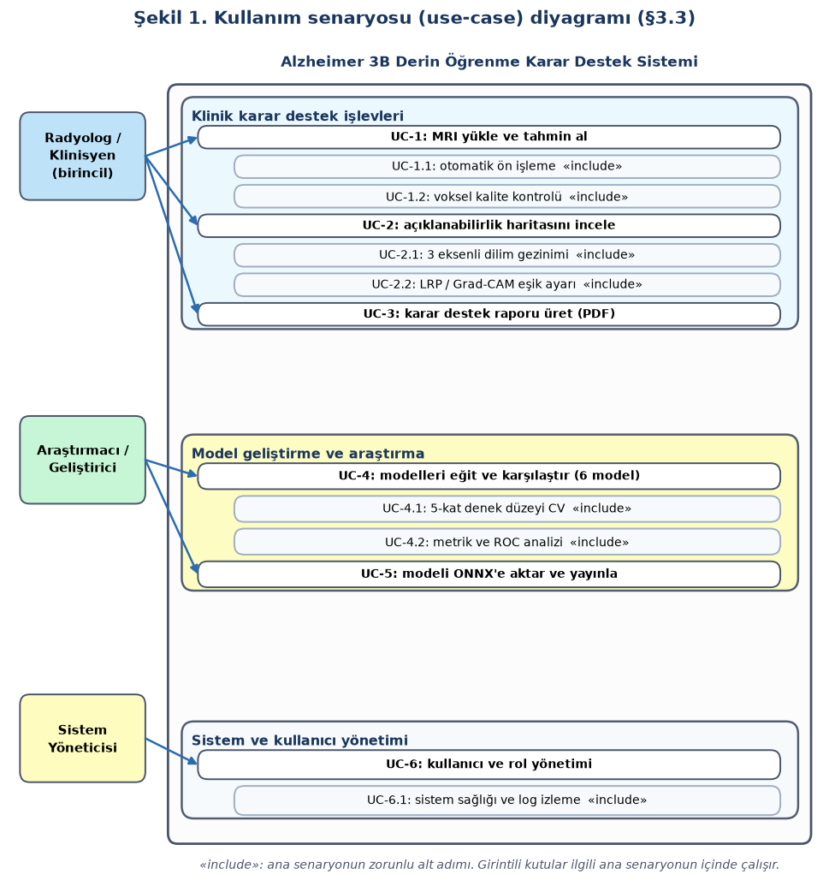
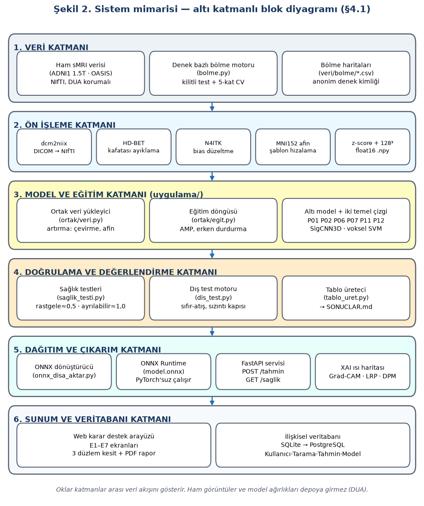
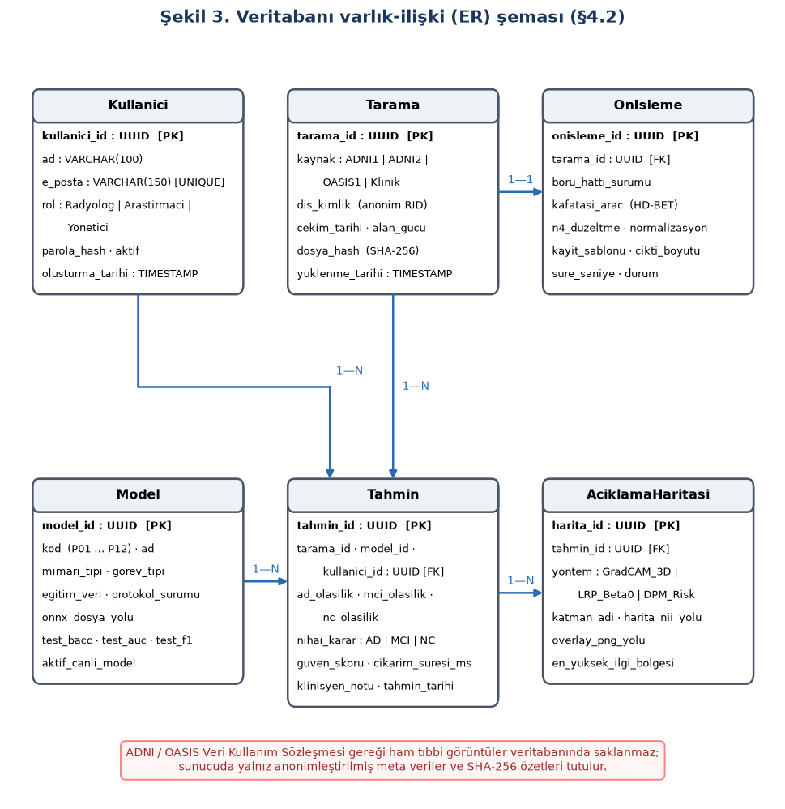
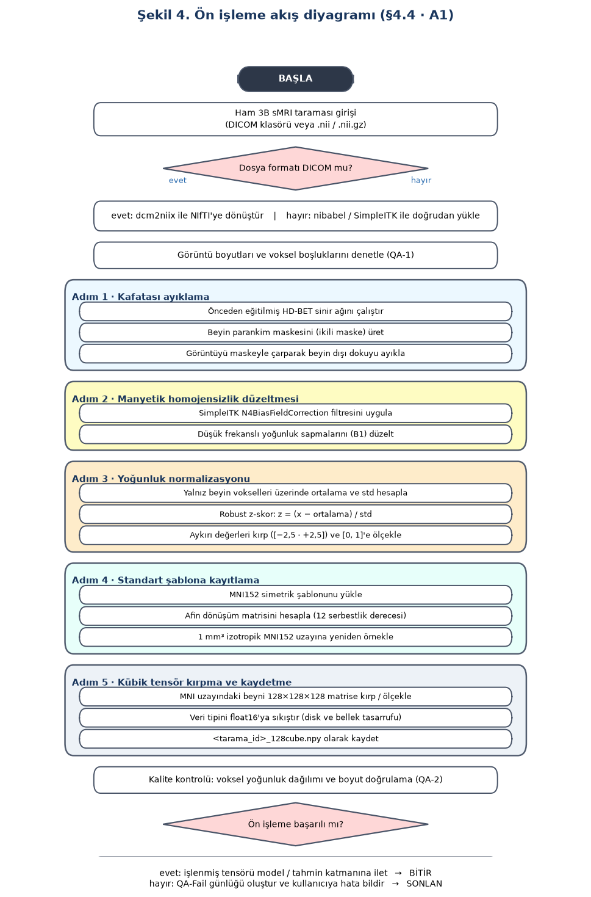
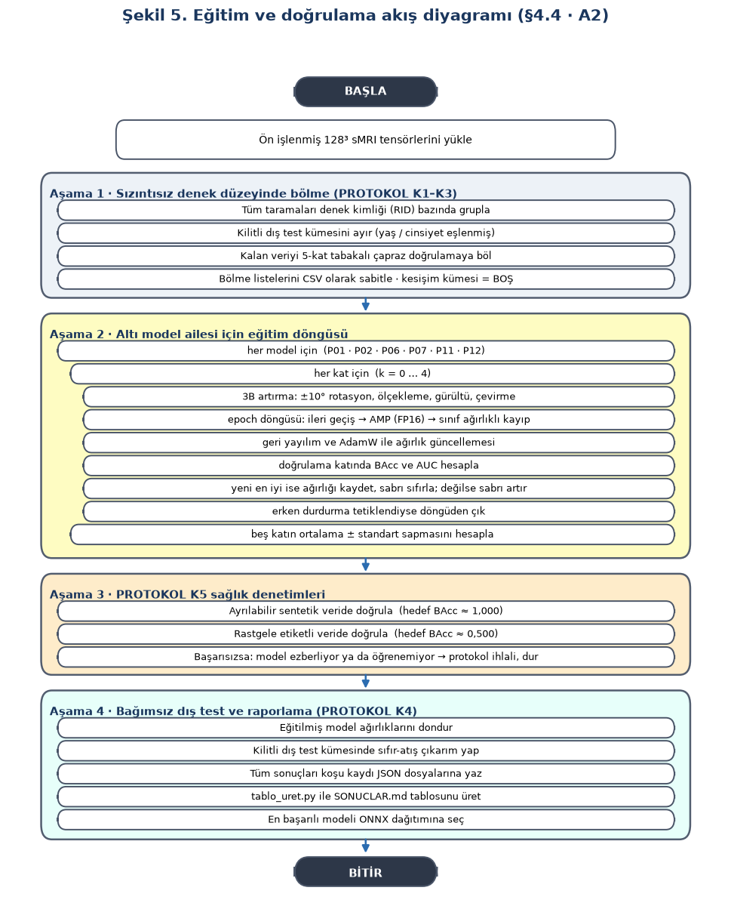
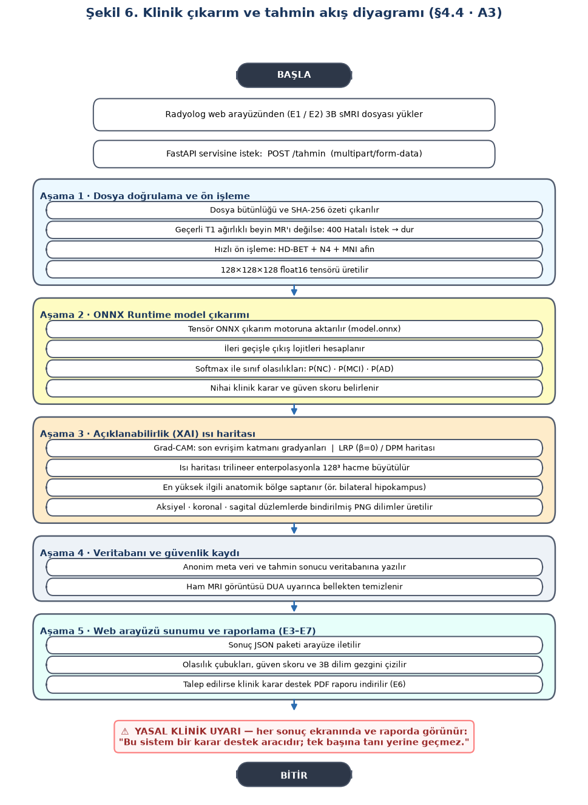

# 2. ARA RAPOR — ANALİZ VE TASARIM

## KAPAK

**Proje adı:** Alzheimer Hastalığının Erken Teşhisi İçin 3B Derin Öğrenme Tabanlı Karar Destek Sistemi Geliştirilmesi

**Öğrenciler:**
Ahmet Görkem Yavuz (G231210032) · Ertuğrul Kabaoğlu (G231210376) · Baran Yeşilyurt (G231210078)

**Danışman:** Dr. Öğr. Üyesi Can Yüzkollar

**Ders:** BSM 401 Bilgisayar Mühendisliği Tasarımı — 2026-2027 Güz

**Teslim tarihi:** ........ 2026

**Proje deposu:** https://github.com/YesilBaraN/tasarim-alzheimer

---

## 1. GİRİŞ

Birinci raporda projeyi tanımlamış, kapsamı çizmiş ve bir plan yapmıştık. O günden bugüne yaptıklarımızı kısaca sıralıyoruz.

- **Literatür.** 27 makale taradık, açık erişim ve açık kod ölçütüyle 15'ini seçtik. Her birimiz beşini okudu ve ortak bir şablonla inceleme notu yazdı. İncelerken dört makalede kendi içinde çelişen sayılar bulduk ve notlara yazdık.
- **Veri.** ADNI ve OASIS için başvurumuzu yaptık, onay bekliyoruz. Onayı beklerken açık erişimli bir veri seti aradık ve OASIS-1 ile OASIS-2'nin işlenmiş halini bulduk. Bu kümeyi hattı gerçek görüntülerle sınamak için kullanıyoruz.
- **Protokol.** Altı modeli adil karşılaştırmak için bağlayıcı beş kural yazdık ve bunları kodla zorladık.
- **Kod.** Ortak eğitim altyapısını, ön işleme hattını ve altı mimarinin tamamını yazdık. Her push'ta Windows ve Linux'ta otomatik test çalışıyor.
- **Tasarım.** Bu raporun asıl konusu olan gereksinimleri çıkardık, mimariyi, veritabanını, arayüzü ve akışları tasarladık. Tasarımı kâğıtta bırakmadık, kodda denedik; bu raporda anlattığımız parçaların çoğu şu an çalışıyor.

### 1.1 Projenin farkı

Literatürde Alzheimer teşhisi için çok sayıda 3B model var ve her biri kendi makalesinde yüksek başarı bildiriyor. Ama bu sayılar birbiriyle kıyaslanamıyor, çünkü her çalışma kendi veri alt kümesini, kendi ön işlemesini ve kendi bölme yöntemini kullanıyor. Wen vd. [3] 32 çalışmanın 16'sında veri sızıntısı olasılığı buldu. Yagis vd. [5] dilim düzeyinde bölmenin doğruluğu 25–55 puan şişirdiğini gösterdi.

Biz yeni bir model önermiyoruz. Altı mimariyi aynı veri, aynı bölme ve aynı eğitim yöntemiyle yan yana koyuyoruz. Bu yüzden önce modelleri değil, onları karşılaştıran protokolü yazdık.

---

## 2. DETAYLI LİTERATÜR TARAMASI

On beş makaleyi üç gruba ayırdık. Her grubu bir kişi okudu.

### 2.1 Üç boyutlu CNN temelleri (Baran Yeşilyurt)

**[1] Korolev vd. (2017).** 3B ağlarda düz mimari (VoxCNN) ile artık bağlantılı mimariyi (VoxResNet) karşılaştırdı. Veri küçük: ADNI'den 231 denek. Alzheimer-sağlıklı ayrımında AUC 0,88 civarı çıktı, ama erken ve geç MCI arasında başarı şans düzeyine düştü. Erken evrenin ne kadar zor olduğunu ilk gösteren çalışmalardan biri. Bir zayıflığı var: model seçimi için ayrı bir doğrulama kümesi yok, bu da hafif bir sızıntı demek. İki mimariyi de alıp alt sınır olarak kullanıyoruz.

**[2] Chen vd. (2019).** Sekiz farklı veri setinden (1.638 hacim) ön eğitilmiş bir 3B ResNet ailesi yayımladı. Ön eğitim, akciğer segmentasyonunda Dice skorunu 75,22'den 87,26'ya çıkardı ve eğitimi 2–10 kat hızlandırdı. Bizim için iki önemi var: ağırlıklar MIT lisanslı, yani kullanabiliriz, ve makale sıfırdan eğitilmiş halin de koşulmasını şart koşuyor. Biz de ResNet-18'i iki ayrı koşuyla (ön eğitimli, sıfırdan) planladık.

**[3] Wen vd. (2020).** Bu bizim protokol kaynağımız. 32 çalışmayı tarayıp 16'sında sızıntı olasılığı buldu, dört sızıntı türü tanımladı. Sonra ADNI, AIBL ve OASIS üzerinde, test kümesi en sona kadar kilitli kalacak şekilde dört yaklaşımı karşılaştırdı. Dengeli doğruluklar: tüm beyin 3B 0,82, hipokampüs 0,89, yama 0,81, 2B dilim 0,76, doğrusal SVM 0,88. Yani basit bir SVM derin ağlarla yarışıyor. Bu yüzden bizim çalışmamıza SVM ve basit CNN temel çizgilerini ekledik.

**[4] Folego vd. (2020).** Tüm beyni giren 26,8 milyon parametreli bir ağ (ADNet) eğitti. Asıl değerli kısım bağımsız dış testi: CADDementia yarışma kümesinde üç sınıflı görevde doğruluk %51,4'te kaldı. İç test başarısı dış genellemeyi garanti etmiyor ve üç sınıflı görev ikili görevden çok daha zor. Bu yüzden üç sınıfı ikincil görev yaptık.

**[5] Yagis vd. (2021).** Bölme yönteminin etkisini ölçen bir deney kurdu. Aynı veriyi denek düzeyinde bölünce AD-sağlıklı doğruluğu %66–70 çıktı, dilim düzeyinde bölünce %94–99. Etiketler rastgele karıştırılınca dilim düzeyi bölme yine %94–96 verdi, denek düzeyi %50'de kaldı. Yani yanlış bölme, öğrenilecek bir şey olmasa bile yüksek skor üretiyor. Protokolümüzün ilk kuralı bundan geliyor.

### 2.2 Dikkat mekanizmaları ve açıklanabilirlik (Ahmet Görkem Yavuz)

Derin öğrenme modellerinin klinikte kullanılmasının önündeki en büyük engel, kararlarının nedenini söylememeleri. Bir model yüksek doğruluk alsa bile, kararını beyin dokusundaki gerçek küçülmeye mi yoksa görüntüdeki başka bir ipucuna mı dayandırdığını bilmemiz gerekiyor. Bu grupta dikkat mekanizmalarını ve açıklama yöntemlerini inceledik.

**[6] Böhle vd. (2019).** 3B ağların kararlarını voksel düzeyinde açıklamak için Katman Bazlı İlgi Yayılımı (LRP) yöntemini uyguladı. ADNI'den 344 denekle (193 AD, 151 sağlıklı) 4 bloklu küçük bir 3B CNN eğitti ve dengeli doğruluk %81,9, AUC 0,88 aldı. Asıl katkısı yöntem karşılaştırması: yaygın kullanılan Güdümlü Ters Yayılım sağlıklı kişilerde de güçlü tepki üretiyor, LRP ise sağlıklılarda neredeyse sıfır ilgi verip hastalarda hipokampüse ve temporal loba odaklanıyor. LRP skorları hipokampüs hacmiyle ters orantılı (r = −0,56).

**[7] Zhang vd. (2021).** ResNet'e öz-dikkat bloğu ekleyen 3D ResAttNet'i önerdi. ADNI-1'de (817 denek) AD-sağlıklı ayrımında %91,3 doğruluk ve 0,984 AUC aldı. Dikkat çekici olan nokta, sonuçların kararlılığı: standart sapma temel ResNet'te %14,7 iken burada %1,2. Ara katmandan alınan Grad-CAM haritaları, son katmandan alınanlardan çok daha keskin ve hipokampüs sınırını net gösteriyor.

**[8] Dyrba vd. (2021).** LRP haritalarını etkileşimli bir web arayüzüyle birleştirdi. 663 denekle eğittiği modeli, üç bağımsız kohortta (toplam 1.655 denek) sınadı ve hepsinde AUC 0,91'in üstünde kaldı. Haritalar hipokampüs hacmiyle güçlü bir ters ilişki gösterdi (r = −0,87). Açıklamanın "güzel bir görüntü" olmaktan çok ölçülebilir bir şey olduğunu gösteriyor.

**[9] Hoang vd. (2023).** 2B görüntülerde kullanılan CBAM dikkat modülünü 3B'ye uyarladı (3D-DAM). ADNI'den 1.426 deneğin taramalarını Clinica'nın `t1-linear` hattıyla işledi. İç testte AD-sağlıklı doğruluğu %98,18, ama bağımsız OASIS-1 kümesinde %83,42. İç ve dış başarı arasındaki bu fark, dış testin neden şart olduğunu iyi gösteriyor.

**[10] Jin vd. (2020).** ResNet-18'e tek bir evrişim katmanıyla uzamsal dikkat haritası ekleyen hafif bir model (3DAN) geliştirdi. Çin'deki altı hastane ve ADNI'den toplam 1.832 denek kullandı. Dış testlerde doğruluk %86–87'de kaldı. Dikkat haritalarını beyin atlasıyla eşleştirip bilişsel test skorları, amiloid/tau düzeyleri ve APOE genotipiyle ilişkilendirdi; yani haritalar gerçek biyolojiye karşılık geliyor.

### 2.3 Yama/FCN, DenseNet ve Transformer (Ertuğrul Kabaoğlu)

**[11] Qiu vd. (2020).** Tam evrişimli bir ağla tüm beyin için bir hastalık olasılık haritası üretti. Ağ 47×47×47'lik yamalarla eğitiliyor, çıkarımda ise tam bağlantılı katmanlar evrişime çevrilerek tüm beyin tek geçişte işleniyor. Yalnız MR ile %83,4 doğruluk aldı, bu on bir uzman nörologun ortalamasından (%82,3) yüksek. Otopsi yapılmış on bir hastada modelin işaret ettiği bölgeler gerçek patolojiyle örtüştü. Kodu MIT lisanslı, beşinci modelimizin temeli bu.

**[12] Solano-Rojas ve Villalón-Fonseca (2021).** Ücretsiz bulut kaynaklarıyla çalışan bir 3B DenseNet-121 önerdi. İncelerken iki sorun bulduk. Birincisi, özette %87, metinde %84 doğruluk yazıyor. İkincisi ve daha önemlisi, eğitim/test ayrımı denek düzeyinde değil tarama düzeyinde, rastgele %75/%25 yapılmış. Aynı hastanın farklı vizitleri hem eğitime hem teste düşmüş, yani ciddi bir veri sızıntısı var. Biz DenseNet-121'i denek düzeyinde bölmeyle yeniden gerçekleştiriyoruz.

**[13] Lian vd. (2020).** Çok ölçekli yamalarla çalışan hiyerarşik bir tam evrişimli ağ (H-FCN) önerdi. ADNI-1'de 830 denekle AD-sağlıklı ayrımında %90,3 doğruluk, 0,951 AUC elde etti. ADNI-2'de eğitip ADNI-1'de test edince %89,5 aldı. Sızıntısız kurulumlardaki en güçlü referanslardan biri; hedefimizi belirlerken bunu üst sınır olarak aldık.

**[14] Jang ve Hwang (2022).** 3B CNN, 2B CNN ve Transformer'ı birleştiren hibrit bir model (M3T) önerdi. ADNI test kümesinde %93,21, OASIS'te %85,26 doğruluk aldı. Saf 3B Vision Transformer ise belirgin şekilde geride kaldı (AUC 0,885). Yani Transformer tek başına yetmiyor, CNN ön eğitimi gerekiyor.

**[15] Dhinagar vd. (2023).** Farklı ön eğitim kaynaklarının (video, sentetik MR, UK Biobank) ViT ve CNN mimarilerine etkisini karşılaştırdı. Sıfırdan eğitimde 3B DenseNet-121 (AUC 0,901) saf Transformer'ları (0,849) geçti. En ilginç bulgu: 1,8 milyon parametreli küçük bir DenseNet, 11 milyonluk DenseNet-121'le neredeyse aynı sonucu verdi (%83,6'ya karşı %84,0). Büyük model her zaman daha iyi değil.

### 2.4 On beş makalenin özeti

| Kod | Çalışma | Veri (N) | Sızıntı riski | En iyi sonuç | Projedeki rolü |
|---|---|---|---|---|---|
| P01 | Korolev 2017 | ADNI 231 denek | orta | AUC 0,88 | Model 1 · alt sınır |
| P02 | Chen 2019 | 1.638 hacim | orta | aktarımda +12 Dice | Model 2 · transfer |
| P03 | Wen 2020 | ADNI 1.455 · AIBL 598 · OASIS 193 | düşük | 3B 0,82 · SVM 0,88 | **Protokol kaynağı** |
| P04 | Folego 2020 | ADNI1 845 denek | orta | dış test %51,4 | Üç sınıfın zorluğu |
| P05 | Yagis 2021 | OASIS · ADNI · PPMI | karşılaştırma | +25–55 puan şişme | **Bölme kuralının kanıtı** |
| P06 | Böhle 2019 | ADNI-1, 344 denek | düşük | BAcc %81,9 | Model 3 · LRP |
| P07 | Zhang 2021 | ADNI-1, 817 denek | düşük | AUC 0,984 | Model 4 · öz-dikkat |
| P08 | Dyrba 2021 | 663 + 1.655 dış | düşük | AUC ≥ 0,91 | Açıklama doğrulama ölçütü |
| P09 | Hoang 2023 | ADNI 1.426 denek | düşük | %98,2 iç · %83,4 dış | Dikkat modülü referansı |
| P10 | Jin 2020 | 1.832 denek | düşük | dış %86–87 | Biyobelirteç doğrulama |
| P11 | Qiu 2020 | ADNI + 3 dış kohort | düşük | %83,4 | Model 5 · FCN-yama |
| P12 | Solano-Rojas 2021 | ADNI 5.370 tarama | **yüksek** | %84 (sızıntılı) | Model 6 · DenseNet |
| P13 | Lian 2020 | ADNI-1 830 denek | düşük | %90,3 | Hedef üst sınır |
| P14 | Jang 2022 | ADNI 4.786 tarama | düşük | %93,2 · OASIS %85,3 | Dış test hedefi |
| P15 | Dhinagar 2023 | UK Biobank + ADNI | düşük | DenseNet AUC 0,901 | Ön eğitim stratejisi |

### 2.5 Literatürden çıkardığımız kararlar

1. **Bölme her zaman denek düzeyinde olacak.** Aksi halde sonuçlar 25–55 puan şişiyor [3], [5].
2. **%85 hedefi yalnız AD-sağlıklı görevinde gerçekçi.** Üç sınıflı görevde sızıntısız dış test sonuçları %50–60 civarında [3], [4]. Bu görevi ikincil tutup dürüstçe raporlayacağız.
3. **Altı mimariyi aynı ön işleme ve aynı protokolle karşılaştıracağız.** Literatürdeki eksik tam bu.
4. **Temel çizgisiz derin öğrenme sonucu anlamsız.** Wen vd. [3] doğrusal SVM ile 0,88 almış; bu yüzden basit CNN ve SVM temel çizgileri koyduk.
5. **Açıklanabilirlik sistemin parçası.** Kararın hangi bölgeden geldiğini göstermeyen bir sistem klinikte kullanılamaz [6], [7], [8].

---

## 3. GEREKSİNİM ANALİZİ

### 3.1 İşlevsel gereksinimler

| No | Gereksinim | Öncelik |
|---|---|---|
| FR-1 | Sistem T1 ağırlıklı 3B MR'ı NIfTI (.nii / .nii.gz) veya DICOM klasörü olarak kabul eder | Zorunlu |
| FR-2 | Ön işleme (kafatası ayıklama, bias düzeltme, normalizasyon, MNI hizalama, 128³ boyutlandırma) otomatik çalışır ve her adımın çıktısı kaydedilir | Zorunlu |
| FR-3 | Eğitilmiş modelden AD / MCI / NC olasılıkları ve ikili AD-NC kararı üretilir | Zorunlu |
| FR-4 | Karar için açıklama haritası (Grad-CAM veya LRP) üretilir ve MR üzerine bindirilerek gösterilir | Zorunlu |
| FR-5 | Altı model aynı veri ve protokolle eğitilir, sonuçlar tek tabloda karşılaştırılır | Zorunlu |
| FR-6 | En iyi model ONNX'e aktarılır ve PyTorch kurulu olmayan ortamda çalışır | Zorunlu |
| FR-7 | REST API ile (`POST /tahmin`) görüntü gönderilip JSON sonuç alınır | Zorunlu |
| FR-8 | Web arayüzü: görüntü yükle, sonuç, ısı haritası, güven skoru, PDF rapor | İstenen |
| FR-9 | Tahmin kayıtları (meta veri, sonuç, model sürümü, zaman) veritabanında saklanır | İstenen |
| FR-10 | Kullanıcı girişi ve rol yönetimi (radyolog / araştırmacı / yönetici) | İsteğe bağlı |

### 3.2 İşlevsel olmayan gereksinimler

| No | Gereksinim | Ölçüt |
|---|---|---|
| NFR-1 | **Başarım:** AD-NC testinde dengeli doğruluk ≥ %85, AUC ≥ 0,90; üç sınıf dürüstçe raporlanır | Protokolle ölçülür |
| NFR-2 | **Yanıt süresi:** tek görüntü için ön işleme + tahmin ≤ 5 dk (CPU), ≤ 30 sn (GPU) | ölçülecek |
| NFR-3 | **Tekrarlanabilirlik:** sabit tohum, kayıtlı bölme listeleri, sabit sürümler, her koşuda git commit kaydı | kontrol listesi |
| NFR-4 | **Gizlilik:** ADNI/OASIS veri sözleşmesine uyum; ham görüntü sunucuda kalıcı saklanmaz | tasarım kararı |
| NFR-5 | **Taşınabilirlik:** Windows ve Linux, GPU'lu veya GPU'suz; ONNX ile çerçeveden bağımsız | otomatik test |
| NFR-6 | **Lisans:** yalnız MIT / Apache / BSD bileşenler; GPL kod alınmaz | envanter tablosu |
| NFR-7 | **Kullanılabilirlik:** hekim üç tıkla sonuca ulaşır; her sonuç ekranında "karar desteğidir, tanı değildir" uyarısı bulunur | kullanıcı testi |
| NFR-8 | **Bakım:** modüler yapı, her model ayrı klasörde, sürüm kontrolü | yapı denetimi |

### 3.3 Kullanım senaryoları

**Aktörler:** radyolog / klinisyen (birincil kullanıcı), araştırmacı, sistem yöneticisi.

| UC | Ad | Aktör | Akış |
|---|---|---|---|
| UC-1 | MR yükle ve tahmin al | Radyolog | NIfTI/DICOM seç → ön işleme → model → olasılık ve karar |
| UC-2 | Açıklama haritasını incele | Radyolog | UC-1'den sonra ısı haritasını aç/kapat, üç düzlemde gez |
| UC-3 | Rapor üret | Radyolog | Sonuç + harita + model sürümü → PDF |
| UC-4 | Modelleri eğit ve karşılaştır | Araştırmacı | Veri seti seç → protokol → altı model → sonuç tablosu |
| UC-5 | Modeli yayınla | Araştırmacı | En iyi modeli ONNX'e aktar → API'ye bağla |
| UC-6 | Kullanıcı ve rol yönet | Yönetici | Kullanıcı ekle, rol ata, sistem sağlığını izle |

---

## 4. TASARIM

### 4.1 Sistem mimarisi

Sistem altı katmanlı. Veri katmanlar arasında tek yönde akıyor, bu sayede her katman ayrı ayrı test edilebiliyor.

1. **Veri katmanı.** Ham görüntüler dış diskte duruyor, depoya girmiyor. Bölme motoru denek düzeyinde kilitli bir test kümesi ve beş katlı çapraz doğrulama üretiyor. Depoya yalnız denek kimliği, bölüm ve kat numarası içeren bir harita giriyor; böylece üçümüz birebir aynı bölmeyi kullanıyoruz ama veri sözleşmesini çiğnemiyoruz.
2. **Ön işleme katmanı.** DICOM dönüştürme, kafatası ayıklama (HD-BET), bias düzeltme (N4), MNI152 hizalama, z-skor normalizasyonu ve 128³ boyutlandırma. Her adımın süresi ve uyarıları bir meta dosyasına yazılıyor.
3. **Model ve eğitim katmanı.** Veri yükleyici ve eğitim döngüsünü bir kez yazdık. Modeller sadece tek satırlık bir arayüz sözleşmesini uyguluyor. Bu karşılaştırmanın adil olmasının teknik güvencesi: kimse kendi eğitim döngüsünü yazmıyor.
4. **Doğrulama katmanı.** Sağlık testleri hattın kendisini denetliyor, dış test motoru başka bir veri setinde sınıyor, tablo üreteci sonuçları tabloya döküp protokole uymayan koşuları ayıklıyor.
5. **Dağıtım katmanı.** Seçilen model ONNX'e aktarılıyor ve `onnxruntime` ile çalışıyor.
6. **Sunum katmanı.** Web arayüzü ve veritabanı.

### 4.2 Veritabanı tasarımı

ADNI ve OASIS görüntüleri veritabanına konmuyor, bu veri sözleşmesinin gereği. Veritabanında yalnız anonim meta veriler, SHA-256 özetleri ve tahmin kayıtları duruyor. Geliştirmede SQLite kullanılacak, gerekirse PostgreSQL'e geçilebilir.

| Varlık | Birincil anahtar | Temel alanlar | İlişki |
|---|---|---|---|
| Kullanici | kullanici_id | ad, e_posta, rol, parola_hash | 1—N Tahmin |
| Tarama | tarama_id | kaynak, dis_kimlik (anonim), cekim_tarihi, alan_gucu, dosya_hash | 1—1 OnIsleme · 1—N Tahmin |
| OnIsleme | onisleme_id | surum, kafatasi_arac, n4, kayit_sablonu, cikti_boyutu, durum | N—1 Tarama |
| Model | model_id | kod, mimari_tipi, gorev_tipi, onnx_yolu, test_bacc, test_auc | 1—N Tahmin |
| Tahmin | tahmin_id | olasılıklar, nihai_karar, guven_skoru, cikarim_suresi_ms | N—1 Tarama, Model, Kullanici |
| AciklamaHaritasi | harita_id | yontem, katman_adi, harita_yolu, en_yuksek_ilgi_bolgesi | N—1 Tahmin |

### 4.3 Arayüz prototipleri

Arayüzün hedefi, hekimin üç tıklamayla hem sonuca hem açıklama haritasına ulaşması. Ekranların ayrıntısı `rapor/sekiller/mockups_spec.md` dosyasında.

| Ekran | İçerik |
|---|---|
| E1 Giriş | Oturum açma, rol seçimi, veri gizliliği bildirimi |
| E2 Yükle | NIfTI/DICOM yükleme, otomatik anonim kimlik, meta veri denetimi |
| E3 İşleniyor | Dört adımlı ilerleme çubuğu ve kalan süre |
| E4 Sonuç | Olasılık çubukları, güven skoru, zorunlu yasal uyarı, model sürümü |
| E5 Isı haritası | Üç düzlemde senkronize dilim kaydırıcıları, şeffaflık ve eşik filtreleri, bölge etiketi |
| E6 Rapor | Kesit görselli, sorumluluk reddi içeren PDF önizleme ve indirme |
| E7 Model karşılaştırma | Araştırmacı modu: sonuç tablosu, ROC eğrileri, karışıklık matrisleri |

Her sonuç ekranında ve her raporda şu uyarı sabit olarak bulunuyor: **"Bu sistem bir karar destek aracıdır; tek başına tanı yerine geçmez."**

### 4.4 Akış diyagramları

Üç ana akış tasarladık: ön işleme, eğitim ve değerlendirme, klinik çıkarım.

**Ön işleme akışı.** Giriş biçimi kontrol edilir, gerekirse NIfTI'ye çevrilir, beş adımlı hattan geçer ve iki kalite kapısıyla denetlenir (girişte ve çıkışta). Kapıdan geçemeyen tarama sessizce kabul edilmez, hata günlüğü oluşur.

**Eğitim ve değerlendirme akışı.** Dört aşamalı: sızıntısız bölme, altı model için eğitim döngüsü, sağlık denetimleri, dış test ve raporlama. Sağlık denetimlerinde hattın rastgele etiketle öğrenmemesi de kanıtlanmak zorunda.

**Klinik çıkarım akışı.** Beş aşamalı: dosya doğrulama ve ön işleme, ONNX çıkarımı, açıklama haritası, veritabanı kaydı, arayüzde sunum. Dördüncü aşamada ham görüntü veri sözleşmesi gereği bellekten silinir.

### 4.5 Adil karşılaştırma protokolü

Tasarımın en önemli parçası mimarilerin kendisi değil, onları karşılaştıran protokol. `uygulama/PROTOKOL.md` beş bağlayıcı kural içeriyor:

| Kural | İçerik | Dayanağı |
|---|---|---|
| K1 | Bölme denek düzeyinde yapılır; aynı kişinin taramaları tek kümede kalır | [3], [5] |
| K2 | Test kümesi kilitlidir; hiperparametre seçimi yalnız doğrulamada yapılır | [3] |
| K3 | Tüm modeller aynı ön işlemeden geçmiş aynı veriyi görür | — |
| K4 | Dış test, eğitim verisiyle kesişmediği doğrulandıktan sonra yapılır | [4], [14] |
| K5 | Hat, sentetik veriyle sağlık testinden geçmeden sonuç üretemez | [3] |

Bu kuralları belgede bırakmadık, tablo üreteci kodla zorluyor: kurala uymayan koşu sonuç tablosuna girmiyor.

---

## 5. GÜNCELLENMİŞ ZAMAN ÇİZELGESİ

| İş | H5 | H6 | H7 | H8 | H9 | H10 | H11 | H12 | H13 | H14 |
|---|---|---|---|---|---|---|---|---|---|---|
| ADNI / OASIS erişim başvurusu | ■ | ■ | | | | | | | | |
| 15 makale incelemesi | | ■ | ■ | | | | | | | |
| Gereksinim analizi ve senaryolar | | ■ | ■ | | | | | | | |
| Mimari, ER, akış ve arayüz tasarımı | | | ■ | ■ | | | | | | |
| **Ara Rapor 2 (bu rapor)** | | | | ■ | | | | | | |
| Ön işleme hattı | | | ■ | ■ | ■ | | | | | |
| Altı model eğitimi ve karşılaştırma | | | | ■ | ■ | ■ | | | | |
| Açıklanabilirlik, ONNX, API, arayüz | | | | | | ■ | ■ | | | |
| **Ara Rapor 3** | | | | | | | ■ | | | |
| Final rapor, poster, sunum | | | | | | | | ■ | ■ | ■ |

H5 = 24–30 Ekim · H8 = 14–20 Kasım · H11 = 5–11 Aralık · H14 = 26–28 Aralık 2026.

### 5.1 Hesaplama kaynağı kısıtı

Tam protokol (9 model × 2 görev × 5 kat × 3 tohum = 270 koşu) ölçümlerimize göre kabaca 270–540 GPU-saat tutuyor. Elimizdeki ücretsiz kaynak buna ancak sınırda yetiyor. Bu yüzden koşuları önceliklendirdik: birincil görevde (AD-NC) tam protokol, ikincil üç sınıf görevinde beş kat ve tek tohum. Bu bir sapma ve raporda açıkça yazılacak. Ayrıntı `karsilastirma/KOSU-PLANI.md` dosyasında.

### 5.2 Danışmana sorularımız

1. Hedef metrik: AD-NC görevinde dengeli doğruluk ≥ %85 birincil, üç sınıf ikincil. Bu ayrım uygun mu?
2. Kaynak kısıtı yüzünden ikincil görevde tohum tekrarını azaltmak kabul edilebilir mi?
3. ADNI onayı gecikirse, açık erişimli köprü veriyle savunmaya girmek uygun olur mu?
4. Üçüncü ve dördüncü ara rapor tarihleri, kaynak biçimi (IEEE öneriyoruz), sayfa sınırı ve benzerlik oranı sınırı nedir?

---

## KAYNAKLAR

[1] S. Korolev, A. Safiullin, M. Belyaev, Y. Dodonova, "Residual and plain convolutional neural networks for 3D brain MRI classification," *IEEE ISBI*, 2017.

[2] S. Chen, K. Ma, Y. Zheng, "Med3D: Transfer learning for 3D medical image analysis," *arXiv:1904.00625*, 2019.

[3] J. Wen vd., "Convolutional neural networks for classification of Alzheimer's disease: Overview and reproducible evaluation," *Medical Image Analysis*, c. 63, 2020.

[4] G. Folego vd., "Alzheimer's disease detection through whole-brain 3D-CNN MRI," *Frontiers in Bioengineering and Biotechnology*, c. 8, 2020.

[5] E. Yagis vd., "Effect of data leakage in brain MRI classification using 2D convolutional neural networks," *Scientific Reports*, c. 11, 2021.

[6] M. Böhle, F. Eitel, M. Weygandt, K. Ritter, "Layer-wise relevance propagation for explaining deep neural network decisions in MRI-based Alzheimer's disease classification," *Frontiers in Aging Neuroscience*, c. 11, 2019.

[7] X. Zhang vd., "An explainable 3D residual self-attention deep neural network for joint atrophy localization and Alzheimer's disease diagnosis using structural MRI," *IEEE J. Biomed. Health Inform.*, 2021.

[8] M. Dyrba vd., "Improving 3D convolutional neural network comprehensibility via interactive visualization of relevance maps: Evaluation in Alzheimer's disease," *Alzheimer's Research & Therapy*, 2021.

[9] G. M. Hoang vd., "A reproducible 3D convolutional neural network with dual attention module (3D-DAM) for Alzheimer's disease classification," *arXiv:2310.12574*, 2023.

[10] D. Jin vd., "Generalizable, reproducible, and neuroscientifically interpretable imaging biomarkers for Alzheimer's disease," *Advanced Science*, 2020.

[11] S. Qiu vd., "Development and validation of an interpretable deep learning framework for Alzheimer's disease classification," *Brain*, c. 143, sy. 6, 2020.

[12] B. Solano-Rojas, R. Villalón-Fonseca, "A low-cost three-dimensional DenseNet neural network for Alzheimer's disease early discovery," *Sensors*, c. 21, 2021.

[13] C. Lian vd., "Hierarchical fully convolutional network for joint atrophy localization and Alzheimer's disease diagnosis using structural MRI," *IEEE TPAMI*, c. 42, 2020.

[14] J. Jang, D. Hwang, "M3T: Three-dimensional medical image classifier using multi-plane and multi-slice transformer," *IEEE/CVF CVPR*, 2022.

[15] N. J. Dhinagar vd., "Video and synthetic MRI pre-training of 3D vision architectures for neuroimage analysis," *arXiv:2309.04651*, 2023.

[16] Alzheimer's Disease Neuroimaging Initiative, "ADNI Data Use Agreement." https://adni.loni.usc.edu

[17] D. S. Marcus vd., "Open Access Series of Imaging Studies (OASIS): Cross-sectional MRI data in young, middle aged, nondemented, and demented older adults," *Journal of Cognitive Neuroscience*, c. 19, sy. 9, 2007.

[18] M. J. Cardoso vd., "MONAI: An open-source framework for deep learning in healthcare," *arXiv:2211.02701*, 2022.

[19] F. Isensee vd., "Automated brain extraction of multisequence MRI using artificial neural networks," *Human Brain Mapping*, c. 40, sy. 17, 2019.

[20] N. J. Tustison vd., "N4ITK: Improved N3 bias correction," *IEEE Transactions on Medical Imaging*, c. 29, sy. 6, 2010.
